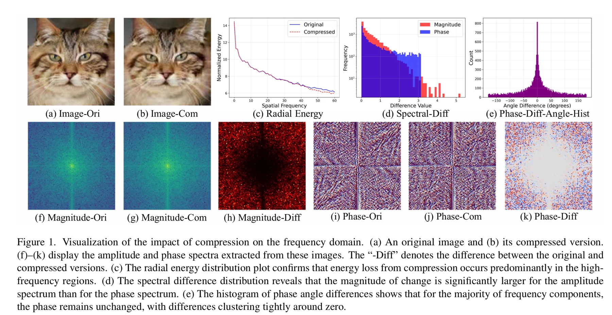
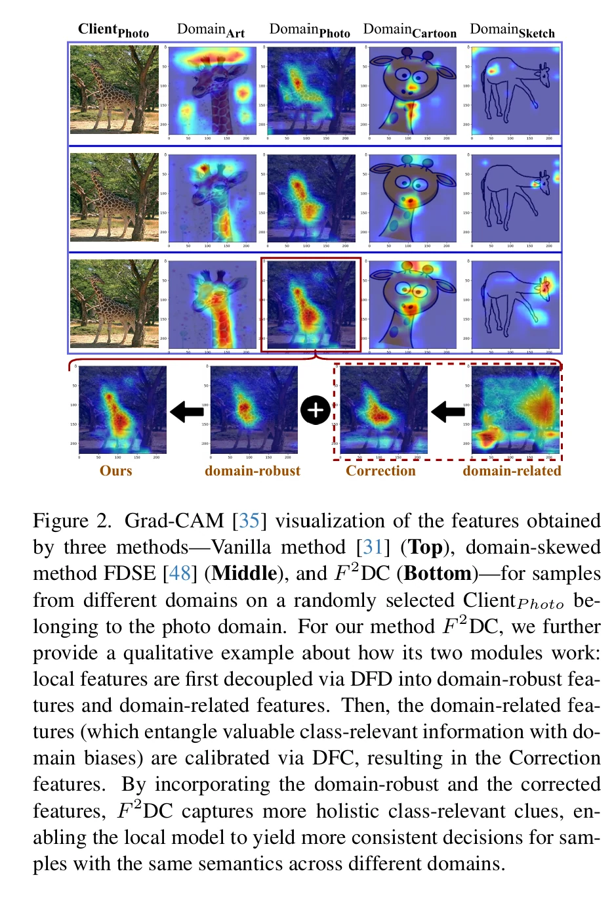
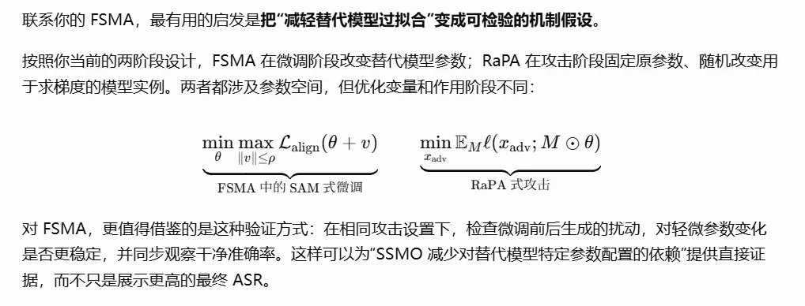


审稿人最集中的疑问其实是：**幅值筛选为何有效、SAM 在这里稳定了什么，以及 FFA 与 SSMO 如何形成共同机制。** 围绕这些问题增加证据，比继续扩展攻击方法更有价值。

[Detecting Compressed AI-Generated Images via Phase Spectrum Robustness](https://openaccess.thecvf.com/content/CVPR2026/papers/Li_Detecting_Compressed_AI-Generated_Images_via_Phase_Spectrum_Robustness_CVPR_2026_paper.pdf)

[Domain-Skewed Federated Learning with Feature Decoupling and Calibration](https://arxiv.org/pdf/2603.14238)

https://arxiv.org/pdf/2504.18594v3


