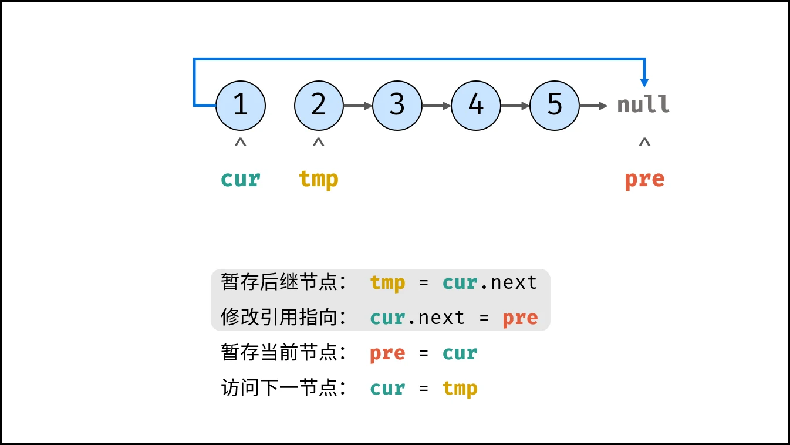
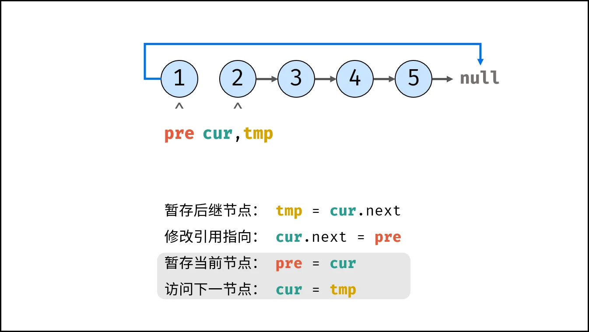
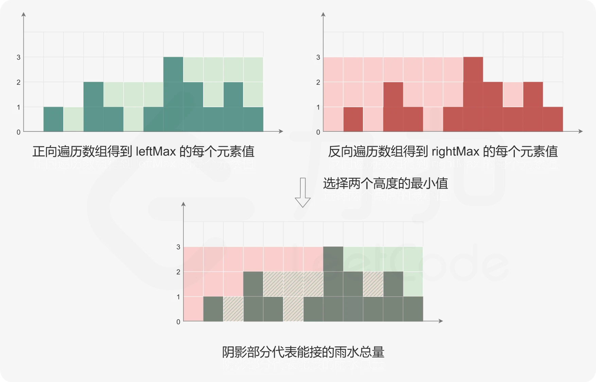
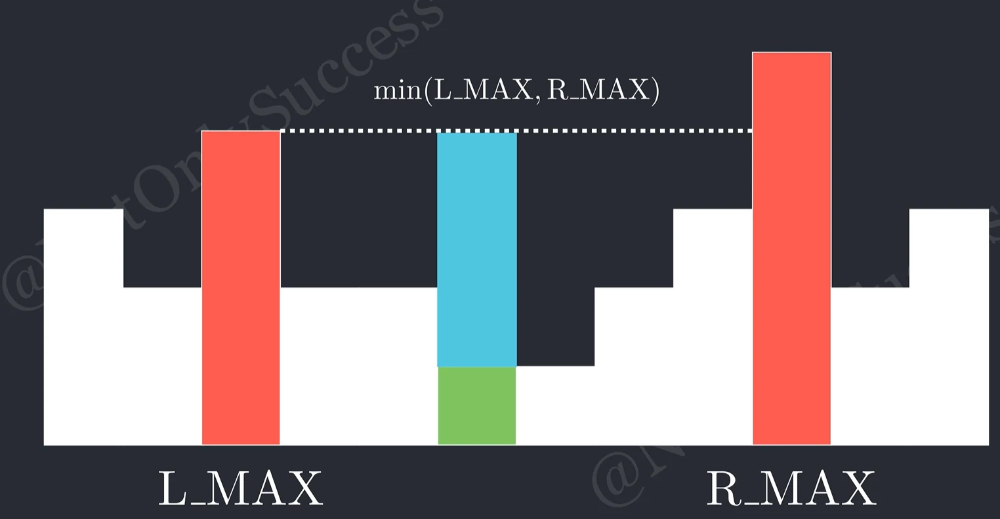
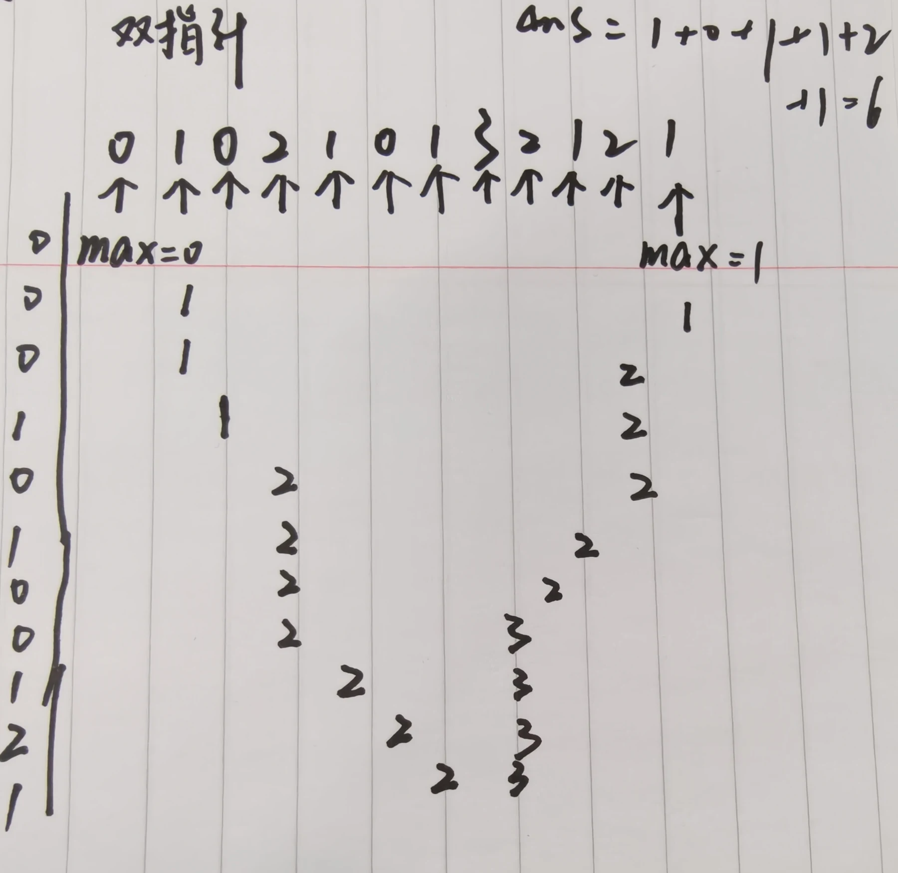
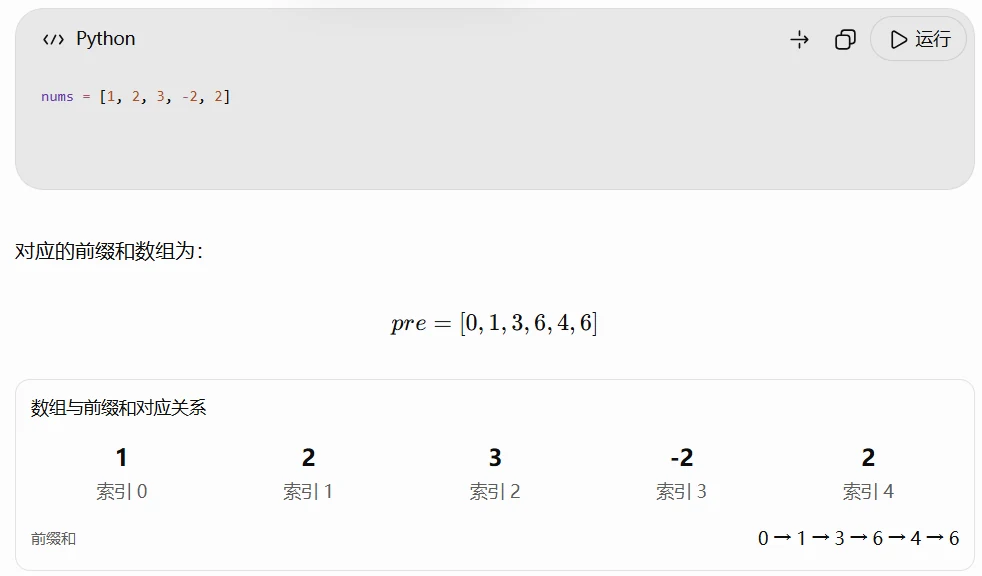
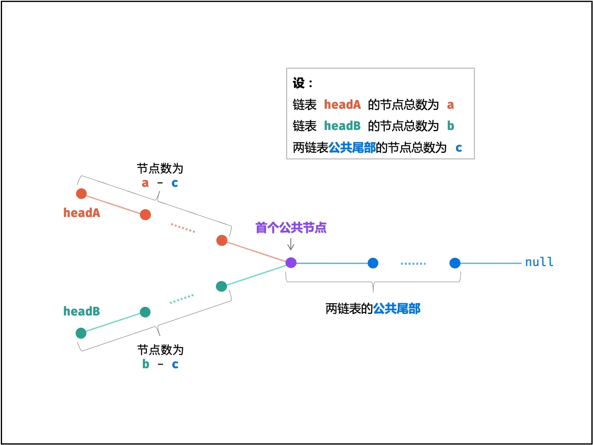
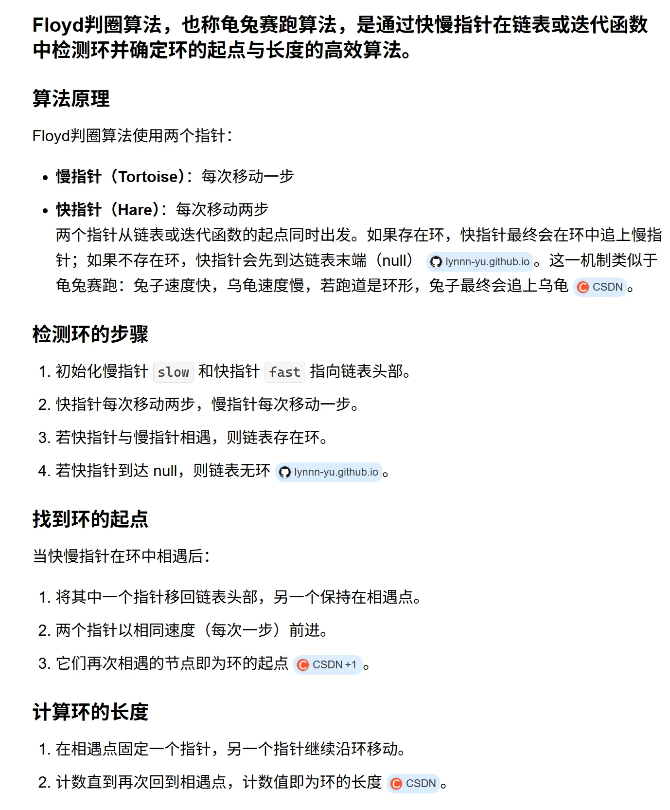
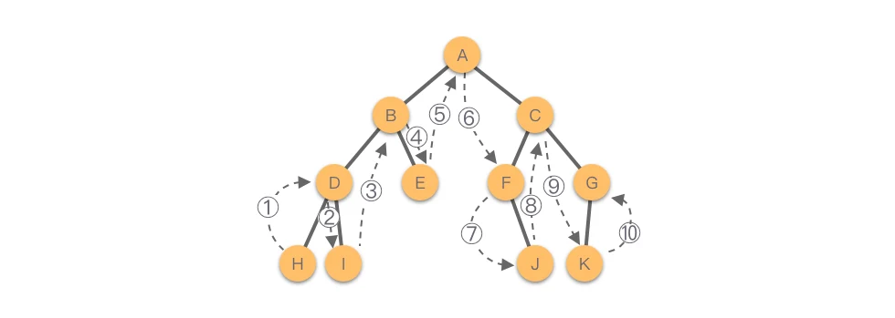


# 哈希表

- 哈希表用来快速判断一个元素是否出现再集合里

- 哈希表是根据关键码的值而直接进行访问的数据结构

当想使用哈希法来解决问题的时候，选择`数组、集合、映射`三种数据结构

- 哈希法也是**牺牲了空间换取了时间**，因为我们要使用额外的数组，set或者是map来存放数据，才能实现快速的查找

## [49. 字母异位词分组 - 力扣（LeetCode）](https://leetcode.cn/problems/group-anagrams/description/?envType=study-plan-v2&envId=top-100-liked)


<div class="code-meta" data-group="py" data-tab="defaultdict" hidden></div>


```python

class Solution:

    def groupAnagrams(self, strs: list[str]) -> list[list[str]]:

        d = defaultdict(list)# 自动创建一个字典，value为空列表

        for s in strs :# 遍历每一个字符串

        # 字母异位词排序后字母顺序相同

            sorted_s = ''.join(sorted(s))# 将s进行排序，作为defaultdict的value

            d[sorted_s].append(s) # 排序后相同的字符串，保存在同一组中

        return list(d.values())# 返回哈希表所有的value

```


<div class="code-meta" data-group="py" data-tab="dict" hidden></div>


```python

class Solution:

    def groupAnagrams(self, strs: list[str]) -> list[list[str]]:

        d = {} # 初始化字典

        for s in strs :

            sorted_s = ''.join(sorted(s))

            if sorted_s not in d: # 首次出现

                d[sorted_s] = [] # 创建列表

            d[sorted_s].append(s)# 排序后相同的字符串保存在同一组中

        return list(d.values())

```


## [128. 最长连续序列 - 力扣（LeetCode）](https://leetcode.cn/problems/longest-consecutive-sequence/?envType=study-plan-v2&envId=top-100-liked)


```python

class Solution:

    def longestConsecutive(self, nums: list[int]) -> int:
        # 不能使用Sorted 因为排序需要O(nlogn)
        num_set = set(nums)
        longest = 0
        
        for num in num_set:
            # num 是一个连续序列的起点
            if num - 1 not in num_set:# 只有当num-1不在数组中，
                current = num# 才说明是连续序列的开始
                length = 1
                # 向后寻找
                while current + 1 in num_set:
                    current += 1
                    length += 1
                longest = max(longest, length)
        return longest

```


# 双指针

- 双指针是一种用**两个位置协同缩小搜索范围**的思考方式
- 明确两个指针
	- 各自含义
	- 移动条件
	- 循环不变量

快指针 `i` 找元素，慢指针 `j` 放元素

## [283. 移动零 - 力扣（LeetCode）](https://leetcode.cn/problems/move-zeroes/?envType=study-plan-v2&envId=top-100-liked)


```python

class Solution:

    def moveZeroes(self, nums: list[int]) -> None:
        """
        Do not return anything, modify nums in-place instead.
        """
        j = 0 # 负责记录“下一个非零元素应该放在哪里”

        for i in range(len(nums)):# 遍历整个数组
            if nums[i] != 0 :
                nums[j] , nums[i] = nums[i] , nums[j]
                j += 1

```

## [11. 盛最多水的容器 - 力扣（LeetCode）](https://leetcode.cn/problems/container-with-most-water/description/?envType=study-plan-v2&envId=top-100-liked)

面积=较短的柱子高度×两柱子之间的距离

面积由两个因素决定：

- 宽度：`j - i`
- 高度：`min(height[i], height[j])`

双指针的核心就是：

> **每次移动较短的那根柱子。**


> 算法流程：
> 1. 初始化： 双指针 i , j 分列水槽左右两端；
> 2. 循环收窄： 直至双指针相遇时跳出；
> 	- 更新面积最大值 res ；
> 	- 选定两板高度中的短板，向中间收窄一格；
> 3. 返回值： 返回面积最大值 res 即可；


<div class="code-meta" data-group="双指针" data-tab="暴力解法" hidden></div>


```python

class Solution:

    def maxArea(self, height: list[int]) -> int:
        max_s = 0
        for i in range(len(height)):
            for j in range(i+1,len(height)):
                s = min(height[i] , height[j]) * (j-i)
                max_s = max(s,max_s)

        return max_s

```


<div class="code-meta" data-group="双指针" data-tab="双指针" hidden></div>


```python

class Solution:
    def maxArea(self, height: List[int]) -> int:
        l, r = 0, len(height) - 1
        ans = 0
        while l < r:# 如果左右指针还没有相遇，就可以构成面积
            area = min(height[l], height[r]) * (r - l)
            ans = max(ans, area)# 更新答案的最大值
            if height[l] <= height[r]:# 如果左边矮
                l += 1# 就把左边右移动
            else:
                r -= 1
        return ans

```


## [15. 三数之和 - 力扣（LeetCode）](https://leetcode.cn/problems/3sum/description/?envType=study-plan-v2&envId=top-100-liked)

a+b+c = 0,重点在于去重
算法流程：
1. 特判，对于数组长度 `n`，如果数组为 `null` 或者数组长度小于 3，返回 `[]`。
2. 对数组进行排序。
3. 遍历排序后数组：
- 若`nums[i]>0`：因为已经排序好，所以后面不可能有三个数加和等于 0，直接返回结果。
- 对于重复元素：跳过，避免出现重复解
- 令左指针` L=i+1`，右指针 `R=n−1`，当 `L<R` 时，执行循环：
	- 当` nums[i]+nums[L]+nums[R]==0`，执行循环，判断左界和右界是否和下一位置重复，去除重复解。并同时将 L,R 移到下一位置，寻找新的解
	- 若和大于 0，说明 `nums[R] `太大，R 左移
	- 若和小于 0，说明 `nums[L] `太小，L 右移

```python

class Solution:

    def threeSum(self, nums: list[int]) -> list[list[int]]:

        result = [] # 结果集

        nums.sort() # 进行排序
		# 遍历数组
        for i in range(len(nums)) :
			# 特别判断，如果第一个值就大于0，因为已经进行了排序，后面相加不可能为0
            if nums[i] > 0 :
                return result

			  # 重复i元素直接跳过避免重复
            if i > 0 and nums[i] == nums[i-1]:
                continue
			# 确定指针位置
            left = i+1
            right = len(nums)-1
			# 左右指针开始循环
            while right > left :
                sum_ = nums[i] + nums[left] + nums[right]
                if sum_ > 0:
                    right -= 1
                elif sum_ < 0:
                    left += 1
                   
                else:# 当和为0的情况，将三个值加入到结果数组中
                    result.append([nums[i], nums[left], nums[right]])
					# 判断左界和右界是否和下一位置重复，去除重复解。
                    while right > left and nums[right] == nums[right-1]:
                        right -=1

                    while right > left and nums[left]==nums[left+1]:
                        left +=1

                    right -=1

                    left +=1

        return result

```

## [206. 反转链表 - 力扣（LeetCode）](https://leetcode.cn/problems/reverse-linked-list/description/)





```python

# Definition for singly-linked list.
# class ListNode:
#     def __init__(self, val=0, next=None):
#         self.val = val
#         self.next = next

class Solution:

    def reverseList(self, head: ListNode | None) -> ListNode | None:
        cur = head
        pre = None
        while cur:
            temp = cur.next # 暂存后继节点
            cur.next = pre # 修改引用指向
            pre = cur# 暂存当前节点
            cur = temp# 访问下一节点
        return pre

```


## [42. 接雨水 - 力扣（LeetCode）](https://leetcode.cn/problems/trapping-rain-water/description/?envType=study-plan-v2&envId=top-100-liked)


<div class="code-meta" data-group="双指" data-tab="前后缀" hidden></div>


```python

class Solution:
    def trap(self, height: list[int]) -> int:
        n = len(height) # 统计数组长度
        pre_max = [0]*n # 初始化数组pre_max表示从左到右的最大值
        pre_max[0] = height[0]
        for i in range(1,n):
            pre_max[i] = max(pre_max[i-1],height[i])

        suf_max = [0]*n # suf_max[i] 表示从 height[i] 到 height[n-1] 的最大值
        suf_max[-1] = height[-1]
        for i in range(n-2,-1,-1):
            suf_max[i] = max(suf_max[i+1],height[i])

        ans = 0
        for h, pre, suf in zip(height,pre_max,suf_max):
            ans += min(pre,suf)-h# 累加每个水桶能接多少水
        return ans


```


<div class="code-meta" data-group="双指" data-tab="双指针" hidden></div>


```python

class Solution:
    def trap(self, height: List[int]) -> int:
        ans = pre_max = suf_max = 0
        left, right = 0, len(height) - 1
        while left < right:
            pre_max = max(pre_max, height[left])  # 前缀最大值
            suf_max = max(suf_max, height[right])  # 后缀最大值
            if pre_max < suf_max:  # 可以确定 left 处的接水量
                ans += pre_max - height[left]
                left += 1  # 搞定了 left，现在问题缩小到 [left+1, right]
            else:  # 可以确定 right 处的接水量
                ans += suf_max - height[right]
                right -= 1  # 搞定了 right，现在问题缩小到 [left, right-1]
        return ans


```

- 前后缀

左边最高的高度和右边最高的高度两者取最小值，和当前高度取差值，就可以求出这个单位的储水量


# 滑动窗口

使用两个指针维护一个连续区间：

- `left`：窗口左边界。
    
- `right`：窗口右边界。

在遍历过程中：

1. 右指针不断向右移动，尝试扩大窗口。
    
2. 如果窗口不满足条件，就移动左指针，缩小窗口。
    
3. 每次窗口合法时，更新最长长度。

整个过程中，左右指针都只向右移动，不需要反复枚举已经处理过的区间。
[209. 长度最小的子数组 - 力扣（LeetCode）](https://leetcode.cn/problems/minimum-size-subarray-sum/submissions/)
右指针正常遍历，左指针根据条件进行移动

```python

class Solution:
    def minSubArrayLen(self, target: int, nums: list[int]) -> int:
    # 时间复杂度O(n)
    # 空间复杂度O(1)
        n = len(nums)
        ans = n + 1 # 方便取最小值的时候
        s = 0 # 和
        left = 0
        for right , x in enumerate(nums):
            s += x
            while s >= target  :
                ans = min(ans , right-left+1)
                s -= nums[left]
                left +=1
        return ans if ans <= n else 0

```

## [3. 无重复字符的最长子串 - 力扣（LeetCode）](https://leetcode.cn/problems/longest-substring-without-repeating-characters/description/?envType=study-plan-v2&envId=top-100-liked)

- 方法一：滑动窗口+哈希表

只有一层for循环遍历整个数组，在遍历的过程中更新左边界

- 方法二：哈希集合
1. 右指针尝试加入新字符。
2. 如果新字符已经在窗口中，就不断移动左指针。
3. 每移动一次，就删除左边界对应的字符。
4. 直到窗口中不存在重复字符。
5. 加入新字符，更新最大长度。


<div class="code-meta" data-group="滑动窗口" data-tab="哈希表" hidden></div>


```python

class Solution:
    def lengthOfLongestSubstring(self, s: str) -> int:
        # 一旦出现重复字符，需要知道左边界移动到哪里，索引可以直接定位
        dic = {} # 初始化哈希表，字典记录每一个字符最后一次出现的索引位置
        res = 0
        i = -1 # 初始化左边界
        for j in range(len(s)):# 遍历右边界
            if s[j] in dic:
                i = max(dic[s[j]],i)
            dic[s[j]] = j # 更新字符最新位置
            res = max(res,j-i)# 更新最大长度
        return res

```


<div class="code-meta" data-group="滑动窗口" data-tab="哈希集合" hidden></div>


```python

class Solution:
    def lengthOfLongestSubstring(self, s: str) -> int:
	    # 哈希集合记录每个字符是否出现过
        window = set()
        left = 0
        ans = 0
        for right in range(len(s)):
            while s[right] in window:
                window.remove(s[left])
                left += 1
            window.add(s[right])
            ans = max(ans, right - left + 1)
        return ans

```


## [438. 找到字符串中所有字母异位词 - 力扣（LeetCode）](https://leetcode.cn/problems/find-all-anagrams-in-a-string/description/?envType=study-plan-v2&envId=top-100-liked)


<div class="code-meta" data-group="双" data-tab="yy的方法" hidden></div>


```python

# 每次重新排序会造成不必要的计算；定长窗口的方法就是只统计字符的数量不需要比较排序
class Solution:
    def findAnagrams(self, s: str, p: str) -> List[int]:
        res = []
        n = len(p)# 窗口大小
        p_ = ''.join(sorted(p))

        for i in range(len(s)-n+1):
            sq = s[i:i+n]
            s_ = ''.join(sorted(sq))
            if s_ == p_ :
                res.append(i)
        return res

```


<div class="code-meta" data-group="双" data-tab="定长窗口" hidden></div>


```python

# 请选择 Python3 提交代码，而不是 Python
class Solution:
    def findAnagrams(self, s: str, p: str) -> List[int]:
        cnt_p = Counter(p)  # 统计 p 的每种字母的出现次数
        cnt_s = Counter()  # 统计 s 的长为 len(p) 的子串 t 的每种字母的出现次数
        ans = []

        for right, c in enumerate(s):
            cnt_s[c] += 1  # 右端点字母进入窗口

            left = right - len(p) + 1
            if left < 0:  # 窗口长度不足 len(p)
                continue

            if cnt_s == cnt_p:  # t 和 p 的每种字母的出现次数都相同
                ans.append(left)  # t 左端点下标加入答案

            cnt_s[s[left]] -= 1  # 左端点字母离开窗口

        return ans

```


# 子串
## 前缀和

前缀和就是从数组开头开始，依次累加元素。

`sum(nums[i:j]) = pre[j]-pre[i]`这里的 `[i:j]` 是左闭右开的区间。

一般地，任意子数组都是一个前缀去掉前缀后的结果。所以**任意子数组的和，都可以表示为两个前缀和的差**。

通过前缀和，我们可以把子数组的元素和转化成两个前缀和的差，下标区间 `[left,right] `的元素和等于前缀` [0,right] `的元素和减去另一个前缀 `[0,left−1] `的元素和，即`s[right+1]−s[left]`

> **> 以后遇到以下问题，可以优先考虑前缀和：**
> 
> - 求连续子数组的和。
>     
> - 统计和为某个值的子数组数量。
>     
> - 判断是否存在和满足条件的连续区间。
>     
> - 需要快速计算任意区间的元素和。

其中最值得记忆的是：

$\boxed{\text{区间和}=\text{右前缀和}-\text{左前缀和}}$


## [560. 和为 K 的子数组 - 力扣（LeetCode）](https://leetcode.cn/problems/subarray-sum-equals-k/description/?envType=study-plan-v2&envId=top-100-liked)


<div class="code-meta" data-group="前缀和" data-tab="前缀和1" hidden></div>


```python


class Solution:
    def subarraySum(self, nums: List[int], k: int) -> int:
        dic = {0: 1}# 表示在遍历数组之前，已经存在一个前缀和为 0 的空前缀
        pre = 0
        res = 0

        for num in nums:
            pre += num # 更新前缀和 

            if pre - k in dic:
                res += dic[pre - k] # 查找之前有多少个前缀和等于 pre-k

            dic[pre] = dic.get(pre, 0) + 1# 记录当前前缀和出现的次数

        return res


```


<div class="code-meta" data-group="前缀和" data-tab="前缀和2" hidden></div>


```python

class Solution:
    def subarraySum(self, nums: List[int], k: int) -> int:
        s = [0] * (len(nums) + 1)
        for i, x in enumerate(nums):
            s[i + 1] = s[i] + x

        cnt = defaultdict(int)
        ans = 0
        for sj in s:
            ans += cnt[sj - k]
            cnt[sj] += 1
        return ans


```


## [239. 滑动窗口最大值 - 力扣（LeetCode）](https://leetcode.cn/problems/sliding-window-maximum/description/?envType=study-plan-v2&envId=top-100-liked)


<div class="code-meta" data-group="滑动" data-tab="暴力解法" hidden></div>


```python

class Solution:
    def maxSlidingWindow(self, nums: List[int], k: int) -> List[int]:
        n = len(nums)
        res = []

        for i in range(n-k+1):
            m = max(nums[i:i+k])
            res.append(m)
        return res

        

```


<div class="code-meta" data-group="滑动" data-tab="队列" hidden></div>


```python

class Solution:
    def maxSlidingWindow(self, nums: List[int], k: int) -> List[int]:
        ans = [0] * (len(nums) - k + 1)  # 窗口个数
        q = deque()  # 双端队列

        for i, x in enumerate(nums):
            # 1. 右边入
            while q and nums[q[-1]] <= x:
                q.pop()  # 维护 q 的单调性
            q.append(i)  # 注意保存的是下标，这样下面可以判断队首是否离开窗口

            # 2. 左边出
            left = i - k + 1  # 窗口左端点
            if q[0] < left:  # 队首离开窗口
                q.popleft()

            # 3. 在窗口左端点处记录答案
            if left >= 0:
                # 由于队首到队尾单调递减，所以窗口最大值就在队首
                ans[left] = nums[q[0]]

        return ans

```

## [76. 最小覆盖子串 - 力扣（LeetCode）](https://leetcode.cn/problems/minimum-window-substring/?envType=study-plan-v2&envId=top-100-liked)

```python

class Solution:
    def minWindow(self, s: str, t: str) -> str:
        cnt_s = Counter()  # s 子串字母的出现次数
        cnt_t = Counter(t)  # t 中字母的出现次数

        ans_left, ans_right = -1, len(s)
        left = 0

        for right, c in enumerate(s):  # 移动子串右端点
            cnt_s[c] += 1  # 右端点字母移入子串
            while cnt_s >= cnt_t:  # 涵盖
                if right - left < ans_right - ans_left:  # 找到更短的子串
                    ans_left, ans_right = left, right  # 记录此时的左右端点
                cnt_s[s[left]] -= 1  # 左端点字母移出子串
                left += 1

        return "" if ans_left < 0 else s[ans_left: ans_right + 1]

```


# 普通数组

## [53. 最大子数组和 - 力扣（LeetCode）](https://leetcode.cn/problems/maximum-subarray/submissions/?envType=study-plan-v2&envId=top-100-liked)


<div class="code-meta" data-group="数组" data-tab="暴力贪心" hidden></div>


```python

class Solution:
    def maxSubArray(self, nums: list[int]) -> int: 
        ans = float('-inf') # 遍历到目前为止的最大子数组和
        s = 0 # 当前正在考虑的连续子数组和
        # 如果当前子数组的累积和小于 0，就直接放弃它，从下一个元素重新开始
        for x in nums:
            s += x
            ans = max(ans , s)
            if s < 0:
                s = 0
        return ans

```


<div class="code-meta" data-group="数组" data-tab="动态规划" hidden></div>


```python

class Solution:
    def maxSubArray(self, nums: list[int]) -> int:
        # s 是局部最优状态，ans 是全局最优答案。
        s = nums[0] # 以当前元素结尾的最大子数组和
        ans = nums[0] # 截止目前发现的最大子数组和

        for i in range(1, len(nums)):
            s = max(nums[i], s + nums[i]) # 维护局部最优状态
            ans = max(ans, s)# 全局变量保存历史最优解

        return ans

```


## [56. 合并区间 - 力扣（LeetCode）](https://leetcode.cn/problems/merge-intervals/description/?envType=study-plan-v2&envId=top-100-liked)


<div class="code-meta" data-group="合并区间" data-tab="排序1" hidden></div>


```python

class Solution:
    def merge(self, intervals: list[list[int]]) -> list[list[int]]:
        intervals.sort(key = lambda p: p[0] ) # 按照左端点从小到大排序

        ans = []
        for p in intervals:
            if ans and p[0] <= ans[-1][1]:
                ans[-1][1] = max(ans[-1][1],p[1])
            else:
                ans.append(p)
        return ans
        

```


<div class="code-meta" data-group="合并区间" data-tab="排序2" hidden></div>


```python

class Solution:
    def merge(self, intervals: List[List[int]]) -> List[List[int]]:
        intervals.sort(key=lambda p: p[0])  # 按照左端点从小到大排序

        n = len(intervals)
        ans = []
        left, right = inf, -inf

        for i, (l, r) in enumerate(intervals):
            left = min(left, l)
            right = max(right, r)
            # 下一个区间与 [left, right] 不相交
            if i == n - 1 or intervals[i + 1][0] > right:  
                ans.append([left, right])
                left = inf

        return ans

```

## [189. 轮转数组 - 力扣（LeetCode）](https://leetcode.cn/problems/rotate-array/description/?envType=study-plan-v2&envId=top-100-liked)


<div class="code-meta" data-group="轮转" data-tab="负负得正" hidden></div>


```python

# 注：请勿使用切片，会产生额外空间
class Solution:
    def rotate(self, nums: List[int], k: int) -> None:
        def reverse(i: int, j: int) -> None:
            while i < j:
                nums[i], nums[j] = nums[j], nums[i]
                i += 1
                j -= 1

        n = len(nums)
        k %= n  # 轮转 k 次等同于轮转 k % n 次
        reverse(0, n - 1)
        reverse(0, k - 1)
        reverse(k, n - 1)

```


<div class="code-meta" data-group="轮转" data-tab="圆环循环数组" hidden></div>


```python

class Solution:
    def rotate(self, nums: list[int], k: int) -> None:
        """
        Do not return anything, modify nums in-place instead.
        """
        n = len(nums)
        if n == 0:
            return
        k = k % n
        if k == 0:
            return
        start = n - k
        nums[:] = nums[start:] + nums[:start]

```


## [238. 除了自身以外数组的乘积 - 力扣（LeetCode）](https://leetcode.cn/problems/product-of-array-except-self/description/?envType=study-plan-v2&envId=top-100-liked)
$[0-(i-1)]    --i->   [(i+1)-(n-1)]$
- 定义$pre[i]$ 表示从 $nums[0]$ 到 $nums[i−1]$的乘积。
- 定义 $suf[i]$ 表示从 $nums[i+1]$ 到 $nums[n−1]$ 的乘积。
我们可以先计算出从 $nums[0]$ 到 $nums[i−2]$的乘积 $pre[i−1]$，再乘上 $nums[i−1]$，就得到了$ pre[i]$，即
$$pre[i]=pre[i−1]⋅nums[i−1]$$
同理有
$$suf[i]=suf[i+1]⋅nums[i+1]$$
答案的组成为：
$$answer[i] = pre[i] * suf[i]$$


```python

# 前后缀分解
class Solution:
    def productExceptSelf(self, nums: List[int]) -> List[int]:
        n = len(nums)
        
        pre = [1]*n
        #pre[0]代表第一个元素左边所有数字的乘积，但它左边没有数字，所以初始化为1
        for i in range(1,n):
            pre[i] = pre[i-1]*nums[i-1]

        suf = [1]*n
        # suf[n-1]代表最后一个下标元素，右边已经没有数字
        for i in range(n-2, -1,-1):
            suf[i] = suf[i+1]*nums[i+1]
            
        return [p*s for p,s in zip(pre,suf)]

```


# 矩阵
## [73. 矩阵置零 - 力扣（LeetCode）](https://leetcode.cn/problems/set-matrix-zeroes/description/?envType=study-plan-v2&envId=top-100-liked)


```python

class Solution:
    def setZeroes(self, matrix: list[list[int]]) -> None:
        """
        Do not return anything, modify matrix in-place instead.
        """
        m , n = len(matrix) , len(matrix[0])
        # 用两个标记数组分别记录每一行和每一列是否有0出现
        row , col = [False] * m , [False] * n
        # 先遍历一边数组，如果某个元素为0，那么就将该元素所在行和列标记为true
        for i in range(m):
            for j in range(n):
                if matrix[i][j] == 0:
                    row[i] = col[j] = True
        # 再遍历一遍数组，更新原数组
        for i in range(m):
            for j in range(n):
                if row[i] or col[j] :
                    matrix[i][j] = 0
        

```


## [240. 搜索二维矩阵 II - 力扣（LeetCode）](https://leetcode.cn/problems/search-a-2d-matrix-ii/description/?envType=study-plan-v2&envId=top-100-liked) Z字形查找

因为每行、每列都升序排列：

- 如果当前元素 大于 `target`，这一列从当前位置往下的元素只会更大，因此可以排除当前列，向左走。
    
- 如果当前元素 小于 `target`，这一行从当前位置往左的元素只会更小，因此可以排除当前行，向下走。
    
- 如果相等，直接返回 `True`。


```python

class Solution:
    def searchMatrix(self, matrix: List[List[int]], target: int) -> bool:
        if not matrix or not matrix[0]:
            return False

        m, n = len(matrix), len(matrix[0])

        i, j = 0, n - 1  # 从右上角开始

        while i < m and j >= 0:
            if matrix[i][j] == target:
                return True
            elif matrix[i][j] > target:
                j -= 1  # 当前值太大，向左
            else:
                i += 1  # 当前值太小，向下

        return False


```

为什么一定选择右上角或左下角作为起点，而不直接从左上角开始？
> 因为右上角具有两个相反的单调方向：向左减小、向下增大，能够根据一次比较确定排除方向；而左上角向右、向下都是增大的，遇到小于目标的元素时，无法确定应该选择哪个方向。

# 链表
## [160. 相交链表 - 力扣（LeetCode）](https://leetcode.cn/problems/intersection-of-two-linked-lists/description/?envType=study-plan-v2&envId=top-100-liked)


```python

# Definition for singly-linked list.
# class ListNode:
#     def __init__(self, x):
#         self.val = x
#         self.next = None

class Solution:
    def getIntersectionNode(self, headA: ListNode, headB: ListNode) -> Optional[ListNode]:
        A, B = headA, headB
        while A != B:
            A = A.next if A else headB
            B = B.next if B else headA
        return B
        

```

## -/  [234. 回文链表 - 力扣（LeetCode）](https://leetcode.cn/problems/palindrome-linked-list/description/?envType=study-plan-v2&envId=top-100-liked)
方法一：

1. 复制链表值倒数组列表中
2. 使用双指针法判断是否是回文：python比较简单，直接构造一个反向副本比较

```python

# Definition for singly-linked list.
# class ListNode:
#     def __init__(self, val=0, next=None):
#         self.val = val
#         self.next = next
class Solution:
    def isPalindrome(self, head: Optional[ListNode]) -> bool:
        vals = []
        current_node = head
        while current_node is not None:
            vals.append(current_node.val)
            current_node = current_node.next
        return vals == vals[::-1]
        

```

## [141. 环形链表 - 力扣（LeetCode）](https://leetcode.cn/problems/linked-list-cycle/description/?envType=study-plan-v2&envId=top-100-liked)
方法一：遍历所有节点，用一个哈希表存储访问过的节点
方法二：



<div class="code-meta" data-group="链表" data-tab="快慢指针" hidden></div>


```python

class Solution:
    def hasCycle(self, head: Optional[ListNode]) -> bool:
        if not head or not head.next:
            return False
        slow = head
        fast = head.next
        
        while slow != fast :
            if not fast or not fast.next:
                return False
            slow = slow.next
            fast = fast.next.next
        return True

```


<div class="code-meta" data-group="链表" data-tab="哈希表" hidden></div>


```python

class Solution:
    def hasCycle(self, head: ListNode) -> bool:
        seen = set()# 使用哈希表记录是否出现过
        while head:
            if head in seen:# 如果节点在哈希表中出现过了
                return True# 那就说明有环
            seen.add(head)
            head = head.next
        return False

```

## [142. 环形链表 II - 力扣（LeetCode）](https://leetcode.cn/problems/linked-list-cycle-ii/description/?envType=study-plan-v2&envId=top-100-liked)
> 根据：
> 1. f=2s （快指针每次2步，路程刚好2倍）
> 2. f = s + nb (相遇时，刚好多走了n圈）
    推出：s = nb
从head结点走到入环点需要走 ： a + nb， 而slow已经走了nb，那么slow再走a步就是入环点了。
如何知道slow刚好走了a步？ 从head开始，和slow指针一起走，相遇时刚好就是a步

```python

class Solution:
    def detectCycle(self, head: Optional[ListNode]) -> Optional[ListNode]:
        slow = head
        fast = head

        # 第一阶段：判断是否有环
        while fast and fast.next:
            slow = slow.next
            fast = fast.next.next

            if slow is fast:
                break
        else:
            return None

        # 第二阶段：寻找环入口
        slow = head

        while slow is not fast:
            slow = slow.next
            fast = fast.next

        return slow

```


## [21. 合并两个有序链表 - 力扣（LeetCode）](https://leetcode.cn/problems/merge-two-sorted-lists/?envType=study-plan-v2&envId=top-100-liked)
递归

```python

# Definition for singly-linked list.
# class ListNode:
#     def __init__(self, val=0, next=None):
#         self.val = val
#         self.next = next
class Solution:
    def mergeTwoLists(self, list1: ListNode | None, list2: ListNode | None) -> ListNode | None:
        if not list1:# 终止条件，直到两个链表都空
            return list2
        if not list2:
            return list1
		# 递归调用
        if list1.val <= list2.val:
            list1.next = self .mergeTwoLists(list1.next , list2)
            return list1
        else:
            list2.next = self.mergeTwoLists(list1 , list2.next)
            return list2
        

```


## -/ [2. 两数相加 - 力扣（LeetCode）](https://leetcode.cn/problems/add-two-numbers/description/?envType=study-plan-v2&envId=top-100-liked)


<div class="code-meta" data-group="两数相加" data-tab="原地递归" hidden></div>


```python

class Solution:
    # l1 和 l2 为当前遍历的节点，carry 为进位
    def addTwoNumbers(self, l1: Optional[ListNode], l2: Optional[ListNode], carry=0) -> Optional[ListNode]:
        if l1 is None and l2 is None:  # 递归边界
            return ListNode(carry) if carry else None  # 如果进位了，就额外创建一个节点
        if l1 is None:  # 如果 l1 是空的，那么此时 l2 一定不是空节点
            l1, l2 = l2, l1  # 交换 l1 与 l2，保证 l1 非空，从而简化代码
        s = carry + l1.val + (l2.val if l2 else 0)  # 节点值和进位加在一起
        l1.val = s % 10  # 每个节点保存一个数位（直接修改原链表）
        l1.next = self.addTwoNumbers(l1.next, l2.next if l2 else None, s // 10)  # 进位
        return l1

```


<div class="code-meta" data-group="两数相加" data-tab="yy" hidden></div>


```python


class Solution:
    def addTwoNumbers(self, l1: ListNode | None, l2: ListNode | None) -> ListNode | None:
		# carry 是进位
        def dfs(l1, l2, carry):
            # 两个链表都结束，且没有进位
            if not l1 and not l2 and carry == 0:
                return None

            # 获取当前节点的值
            x = l1.val if l1 else 0
            y = l2.val if l2 else 0

            # 当前位求和
            total = x + y + carry

            # 创建当前结果节点
            node = ListNode(total % 10)

            # 递归处理下一位
            node.next = dfs(
                l1.next if l1 else None,
                l2.next if l2 else None,
                total // 10
            )
            return node
        return dfs(l1, l2, 0)


```

## [19. 删除链表的倒数第 N 个结点 - 力扣（LeetCode）](https://leetcode.cn/problems/remove-nth-node-from-end-of-list/description/?envType=study-plan-v2&envId=top-100-liked)
方法一：
方法二：
%22%20viewBox%3D%220%200%20342%20126%22%20width%3D%22100%25%22%20xmlns%3D%22http%3A%2F%2Fwww.w3.org%2F2000%2Fsvg%22%3E%3Cpath%20d%3D%22M49%2061%20H68%20m-5%20-4%20l5%204%20-5%204%22%20stroke%3D%22currentColor%22%20stroke-width%3D%221.4%22%20fill%3D%22none%22%20opacity%3D%22.6%22%2F%3E%3Cpath%20d%3D%22M106%2061%20H125%20m-5%20-4%20l5%204%20-5%204%22%20stroke%3D%22currentColor%22%20stroke-width%3D%221.4%22%20fill%3D%22none%22%20opacity%3D%22.6%22%2F%3E%3Cpath%20d%3D%22M163%2061%20H182%20m-5%20-4%20l5%204%20-5%204%22%20stroke%3D%22currentColor%22%20stroke-width%3D%221.4%22%20fill%3D%22none%22%20opacity%3D%22.6%22%2F%3E%3Cpath%20d%3D%22M277%2061%20H296%20m-5%20-4%20l5%204%20-5%204%22%20stroke%3D%22currentColor%22%20stroke-width%3D%221.4%22%20fill%3D%22none%22%20opacity%3D%22.6%22%2F%3E%3Cpath%20d%3D%22M220%2053%20C222%2022%20300%2022%20310%2053%22%20fill%3D%22none%22%20stroke%3D%22%23249365%22%20stroke-width%3D%222.1%22%2F%3E%3Cpath%20d%3D%22M305%2047%20L310%2053%20L313%2045%22%20fill%3D%22none%22%20stroke%3D%22%23249365%22%20stroke-width%3D%222.1%22%2F%3E%3Cg%3E%3Crect%20x%3D%229%22%20y%3D%2243%22%20width%3D%2240%22%20height%3D%2236%22%20rx%3D%228%22%20fill%3D%22%23EDF0F4%22%20stroke%3D%22%23AFB8C7%22%20stroke-width%3D%221.4%22%2F%3E%3Ctext%20x%3D%2229%22%20y%3D%2266%22%20text-anchor%3D%22middle%22%20font-size%3D%2215%22%20font-weight%3D%22600%22%20fill%3D%22%23273244%22%3ED%3C%2Ftext%3E%3C%2Fg%3E%3Cg%3E%3Crect%20x%3D%2266%22%20y%3D%2243%22%20width%3D%2240%22%20height%3D%2236%22%20rx%3D%228%22%20fill%3D%22%23EDF0F4%22%20stroke%3D%22%23AFB8C7%22%20stroke-width%3D%221.4%22%2F%3E%3Ctext%20x%3D%2286%22%20y%3D%2266%22%20text-anchor%3D%22middle%22%20font-size%3D%2215%22%20font-weight%3D%22600%22%20fill%3D%22%23273244%22%3E1%3C%2Ftext%3E%3C%2Fg%3E%3Cg%3E%3Crect%20x%3D%22123%22%20y%3D%2243%22%20width%3D%2240%22%20height%3D%2236%22%20rx%3D%228%22%20fill%3D%22%23EDF0F4%22%20stroke%3D%22%23AFB8C7%22%20stroke-width%3D%221.4%22%2F%3E%3Ctext%20x%3D%22143%22%20y%3D%2266%22%20text-anchor%3D%22middle%22%20font-size%3D%2215%22%20font-weight%3D%22600%22%20fill%3D%22%23273244%22%3E2%3C%2Ftext%3E%3C%2Fg%3E%3Cg%3E%3Crect%20x%3D%22180%22%20y%3D%2243%22%20width%3D%2240%22%20height%3D%2236%22%20rx%3D%228%22%20fill%3D%22%23DBF3E5%22%20stroke%3D%22%23319A65%22%20stroke-width%3D%221.4%22%2F%3E%3Ctext%20x%3D%22200%22%20y%3D%2266%22%20text-anchor%3D%22middle%22%20font-size%3D%2215%22%20font-weight%3D%22600%22%20fill%3D%22%23273244%22%3E3%3C%2Ftext%3E%3C%2Fg%3E%3Cg%3E%3Crect%20x%3D%22237%22%20y%3D%2243%22%20width%3D%2240%22%20height%3D%2236%22%20rx%3D%228%22%20fill%3D%22%23F6DFDF%22%20stroke%3D%22%23CB8484%22%20stroke-width%3D%221.4%22%2F%3E%3Ctext%20x%3D%22257%22%20y%3D%2266%22%20text-anchor%3D%22middle%22%20font-size%3D%2215%22%20font-weight%3D%22600%22%20fill%3D%22%23273244%22%3E4%3C%2Ftext%3E%3Cpath%20d%3D%22M244%2048%20L269%2074%20M269%2048%20L244%2074%22%20stroke%3D%22%23BC6161%22%20stroke-width%3D%221.6%22%2F%3E%3C%2Fg%3E%3Cg%3E%3Crect%20x%3D%22294%22%20y%3D%2243%22%20width%3D%2240%22%20height%3D%2236%22%20rx%3D%228%22%20fill%3D%22%23DFEAFE%22%20stroke%3D%22%234B7AC7%22%20stroke-width%3D%221.4%22%2F%3E%3Ctext%20x%3D%22314%22%20y%3D%2266%22%20text-anchor%3D%22middle%22%20font-size%3D%2215%22%20font-weight%3D%22600%22%20fill%3D%22%23273244%22%3E5%3C%2Ftext%3E%3C%2Fg%3E%3Ctext%20x%3D%22200%22%20y%3D%2218%22%20font-size%3D%2212%22%20text-anchor%3D%22middle%22%20fill%3D%22%2326945F%22%20font-weight%3D%22600%22%3Eleft%3C%2Ftext%3E%3Cpath%20d%3D%22M200%2023%20V39%22%20stroke%3D%22%2326945F%22%20stroke-width%3D%221.6%22%2F%3E%3Ctext%20x%3D%22314%22%20y%3D%22106%22%20font-size%3D%2212%22%20text-anchor%3D%22middle%22%20fill%3D%22%234B7AC7%22%20font-weight%3D%22600%22%3Eright%3C%2Ftext%3E%3Cpath%20d%3D%22M314%2097%20V83%22%20stroke%3D%22%234B7AC7%22%20stroke-width%3D%221.6%22%2F%3E%3C%2Fsvg%3E)


<div class="code-meta" data-group="删除链表" data-tab="yy的方法" hidden></div>


```python

# Definition for singly-linked list.
# class ListNode:
#     def __init__(self, val=0, next=None):
#         self.val = val
#         self.next = next
class Solution:
    def removeNthFromEnd(self, head: ListNode | None, n: int) -> ListNode | None:
        num = 0
        h = head
        while h is not None:
            h = h.next
            num +=1
        # 删除头节点的情况
        if num == n:
            return head.next
        # 计算删除节点前面有几个节点
        flag = num -n
        cur = head
        # 移动到待删除节点的前一个
        for i in range(flag-1):
            cur = cur.next
        cur.next = cur.next.next
        return head

```


<div class="code-meta" data-group="删除链表" data-tab="前后指针" hidden></div>


```python

class Solution:
    def removeNthFromEnd(self, head: ListNode | None, n: int) -> ListNode | None:
        # 创建虚拟头节点，三个变量都指向
        left = right = dummy = ListNode(next = head)
        for _  in range(n):
            right = right.next # 右指针先走n步
        while right.next:
            left = left.next
            right = right.next# 左右指针一起走
        left.next = left.next.next# 左指针的下一个节点就是目标倒数
        return dummy.next
        

```

## [24. 两两交换链表中的节点 - 力扣（LeetCode）](https://leetcode.cn/problems/swap-nodes-in-pairs/description/?envType=study-plan-v2&envId=top-100-liked)
https://leetcode.cn/problems/swap-nodes-in-pairs/solutions/2374872/tu-jie-die-dai-di-gui-yi-zhang-tu-miao-d-51ap


```python

# Definition for singly-linked list.
# class ListNode:
#     def __init__(self, val=0, next=None):
#         self.val = val
#         self.next = next
class Solution:
    def swapPairs(self, head: ListNode | None) -> ListNode | None:
        node0 = dummy = ListNode(next = head)# 哨兵节点
        node1 = head
        while node1 and node1.next:
            node2 = node1.next
            node3 = node2.next

            node0.next = node2
            node2.next = node1
            node1.next = node3

            node0 = node1
            node1 = node3
        return dummy.next
        

```

## --/[25. K 个一组翻转链表 - 力扣（LeetCode）](https://leetcode.cn/problems/reverse-nodes-in-k-group/description/?envType=study-plan-v2&envId=top-100-liked)没有明白

```python

# Definition for singly-linked list.
# class ListNode:
#     def __init__(self, val=0, next=None):
#         self.val = val
#         self.next = next
class Solution:
    def reverseKGroup(self, head: ListNode | None, k: int) -> ListNode | None:
        # 统计节点个数
        n = 0
        cur = head
        while cur :
            n+=1
            cur = cur.next
        # last_tail是上一组反转后的尾节点
        last_tail = dummy = ListNode(next = head)
        # k个一组处理
        while n>= k:
            n-=k
            pre = None
            cur = last_tail.next
            for _ in range(k):
                nxt = cur.next
                cur.next = pre
                pre = cur
                cur = nxt
            tail = last_tail.next
            tail.next = cur  # 当前组的尾节点指向下一组的起始节点
            last_tail.next = pre  # 上一组的尾节点指向当前组的头节点
            last_tail = tail

        return dummy.next

        

```


# 二叉树

二叉树中往往使用到递归，关键在于：思考整棵树和左右子树的关系

确定递归的**边界条件**

数学归纳法：
1. 证明：当n = 1时命题成立      1作为自然数集合中最小值
2. 证明：若假设在n = m时命题成立，可推导出在n = m+1时命题成立      m代表任意自然数
原理在于：首先证明在某个起点值命题成立，然后证明从一个值到下一个值得过程有效
## [94. 二叉树的中序遍历 - 力扣（LeetCode）](https://leetcode.cn/problems/binary-tree-inorder-traversal/description/?envType=study-plan-v2&envId=top-100-liked)
> 二叉树的序遍历递归实现的基本步骤：
> 	1. 如果当前节点为空，直接返回。
> 	2. 递归遍历左子树。
> 	3. 访问当前节点。
> 	4. 递归遍历右子树。


```python

class Solution:
    def inorderTraversal(self, root: TreeNode | None) -> list[int]:
        res = []
        def inorder(node):
            if not node :
                return root
            inorder(node.left)
            res.append(node.val)
            inorder(node.right)
        inorder(root)
        return res

```


## [104. 二叉树的最大深度 - 力扣（LeetCode）](https://leetcode.cn/problems/maximum-depth-of-binary-tree/description/?envType=study-plan-v2&envId=top-100-liked)
思考整棵树与左右子树的关系
原问题：整棵树
子问题：左子树、右子树

整棵树的最大深度 = max(左子树的最大深度，右子树最大深度) + 1


<div class="code-meta" data-group="最大深度" data-tab="递归调用" hidden></div>


```python

# 深度优先搜索
class Solution:
    def maxDepth(self, root: TreeNode | None) -> int:
	    # 边界条件
        if root is None:
            return 0
        else:
            left_height = self.maxDepth(root.left)
            right_height = self.maxDepth(root.right)
            # +1 是算上当前节点
            return max(left_height,right_height) + 1

```


## [226. 翻转二叉树 - 力扣（LeetCode）](https://leetcode.cn/problems/invert-binary-tree/description/?envType=study-plan-v2&envId=top-100-liked)
注意只要把每一个节点的左右孩子翻转一下，就可以达到整体翻转的效果

这道题目使用前序遍历和后序遍历都可以，唯独中序遍历不方便，因为中序遍历会把某些节点的左右孩子翻转了两次！
不能中序遍历，只能前序或者后序

对每个节点交换它的 left、right 两个孩子指针，再分别递归翻转左右子树，整棵树就完成了镜像。每个节点恰好被访问并交换一次，时间 O(n)；递归栈深等于树高，空间 O(h)


<div class="code-meta" data-group="反转二叉树" data-tab="前序遍历递归" hidden></div>


```python

class Solution:
    def invertTree(self, root: Optional[TreeNode]) -> Optional[TreeNode]:
        if not root:
            return None
        
        root.left , root.right = root.right , root.left
        self.invertTree(root.left)
        self.invertTree(root.right)
        return root


```


## --/[101. 对称二叉树 - 力扣（LeetCode）](https://leetcode.cn/problems/symmetric-tree/description/?envType=study-plan-v2&envId=top-100-liked)

## [543. 二叉树的直径 - 力扣（LeetCode）](https://leetcode.cn/problems/diameter-of-binary-tree/description/?envType=study-plan-v2&envId=top-100-liked)

直径：任意两个节点路径长度中的最大值

换个角度理解：从一个叶子出发向上，再<mark>🔴某个节点</mark>`拐弯` ，向下到达另一个叶子

最长链的两端一定是叶子，因为如果不是叶子还可以继续向下延申

得到的两条链拼起来的路径(最坏情况下也有可能一条链)

```python

# 遍历所有节点，假设在该节点拐弯
# 在当前节点拐弯的直径长度 = 左子树的最长链 + 右子树的最长链 + 2
# 返回给父节点的是以当前节点为根的子树的最长链
class Solution:
    def diameterOfBinaryTree(self, root: Optional[TreeNode]) -> int:
        ans = 0
        def dfs(node) :
            if node is None:
                return -1
            l_len = dfs(node.left) + 1
            r_len = dfs(node.right) + 1
            nonlocal ans
            ans = max(ans, l_len + r_len)
            return max(l_len,r_len)
        dfs(root)
        return ans

```

## [102. 二叉树的层序遍历 - 力扣（LeetCode）](https://leetcode.cn/problems/binary-tree-level-order-traversal/description/?envType=study-plan-v2&envId=top-100-liked)


<div class="code-meta" data-group="层序遍历" data-tab="两个数组" hidden></div>


```python

# 时间复杂度：O(n)  每个节点只遍历一次
# 空间复杂度：O(n)
class Solution:
    def levelOrder(self, root: TreeNode | None) -> list[list[int]]:
        # 使用两个数组
        if root is None :
            return []
        ans = []
        cur = [root]# 当前节点
        while cur :
            nxt = []# 当前节点的子节点
            vals = []# 每一层的值
            for node in cur :
                vals.append(node.val)
                # 判断是否有子节点
                if node.left : nxt.append(node.left)
                if node.right : nxt.append(node.right)
            cur = nxt
            ans.append(vals)
        return ans

```


```python


```


## [108. 将有序数组转换为二叉搜索树 - 力扣（LeetCode）](https://leetcode.cn/problems/convert-sorted-array-to-binary-search-tree/description/?envType=study-plan-v2&envId=top-100-liked)


```python

class Solution:
    def sortedArrayToBST(self, nums: list[int]) -> TreeNode | None:
        if not nums:
            return None
        m = len(nums)//2
        left = self.sortedArrayToBST(nums[:m])
        right = self.sortedArrayToBST(nums[m+1:])
        return TreeNode(nums[m], left, right)

```


## [98. 验证二叉搜索树 - 力扣（LeetCode）](https://leetcode.cn/problems/validate-binary-search-tree/description/?envType=study-plan-v2&envId=top-100-liked)

二叉搜索树，使用中序遍历是自然的做法，中序遍历时，可以将二叉搜索树看作有序数组

如何判断数组是否有序，只需要比较相邻元素大小即可


<div class="code-meta" data-group="验证" data-tab="中序遍历" hidden></div>


```python

class Solution:
    pre = -inf
    def isValidBST(self, root: TreeNode | None) -> bool:
        if root is None:
            return True
        if not self.isValidBST(root.left):
            return False
        if root.val <= self.pre:
            return False
        self.pre = root.val
        return self.isValidBST(root.right)

```


## -/[230. 二叉搜索树中第 K 小的元素 - 力扣（LeetCode）](https://leetcode.cn/problems/kth-smallest-element-in-a-bst/description/?envType=study-plan-v2&envId=top-100-liked)
1. 直接套用中序遍历，但是面试可能需要优化


<div class="code-meta" data-group="k" data-tab="yy次优做法" hidden></div>


```python

class Solution:
    def kthSmallest(self, root: Optional[TreeNode], k: int) -> int:
        res = []
        def f(node):
            if not node:
                return root
            f(node.left)
            res.append(node.val)
            f(node.right)
        f(root)
        return res[k-1]


```


## [199. 二叉树的右视图 - 力扣（LeetCode）](https://leetcode.cn/problems/binary-tree-right-side-view/description/?envType=study-plan-v2&envId=top-100-liked)
直接套用**BFS层序遍历**的模板，每一层的最后一个节点，保存到答案中


```python

class Solution:
    def rightSideView(self, root: Optional[TreeNode]) -> List[int]:
        if root is None:
            return []
        ans = []
        cur = [root]
        while cur :
            ans.append(cur[-1].val)
            nxt = []
            for node in cur:
                if node.left : nxt.append(node.left)
                if node.right : nxt.append(node.right)
            cur = nxt
        return ans

```

## [114. 二叉树展开为链表 - 力扣（LeetCode）](https://leetcode.cn/problems/flatten-binary-tree-to-linked-list/description/?envType=study-plan-v2&envId=top-100-liked)

1. 头插法，从节点6开始，在6前面插入5等等，这样的顺序是先序遍历的逆序，按照‘右-左-根’的顺序遍历二叉树
2. LeetCode 114 二叉树展开为链表的进阶解法是 O(1) 空间的原地指针法：cur 沿右指针逐个处理节点，遇到有左子树的，就沿左子树的右指针走到当前右链末端，把原右子树先接到这个末端节点后面，再把整棵左子树搬到右边、左指针置空。总时间 O(n)、额外空间 O(1)，原地完成


<div class="code-meta" data-group="展开为链表" data-tab="头插法" hidden></div>


```python

# 时间复杂度：o(n)
# 空间复杂度: o(n)
class Solution:
    head = None
    def flatten(self, root: TreeNode | None) -> None:
        if root is None:
            return 
        self.flatten(root.right)
        self.flatten(root.left)
        root.left = None
        root.right = self.head# 在头节点head的前面插入root
        self.head = root# 现在头节点是root

```


```python

# 时间复杂度O(n)
# 空间复杂度O(1)
class Solution:
    def flatten(self, root: TreeNode | None) -> None:

        cur = root
        while cur :
            if cur.left :
                pre = cur.left
                while pre.right :# 找到左子树的最右
                    pre = pre.right
                pre.right = cur.right# 原右子树接到后面
                cur.right = cur.left# 左子树整段搬到右边
                cur.left = None # 左指针清空
            cur = cur.right

```

# 二分查找

## [35. 搜索插入位置 - 力扣（LeetCode）](https://leetcode.cn/problems/search-insert-position/description/?envType=study-plan-v2&envId=top-100-liked)


```python

# lower_bound 返回最小的满足 nums[i] >= target 的 i
# 如果数组为空，或者所有数都 < target，则返回 len(nums)
# 要求 nums 是非递减的，即 nums[i] <= nums[i + 1]

# 闭区间写法
def lower_bound(nums: List[int], target: int) -> int:
    left, right = 0, len(nums) - 1  # 闭区间 [left, right]
    while left <= right:  # 区间不为空
        # 循环不变量：
        # nums[left-1] < target
        # nums[right+1] >= target
        mid = (left + right) // 2
        if nums[mid] < target:
            left = mid + 1  # 范围缩小到 [mid+1, right]
        else:
            right = mid - 1  # 范围缩小到 [left, mid-1]
    return left

# 左闭右开区间写法
def lower_bound2(nums: List[int], target: int) -> int:
    left， right = 0, len(nums)  # 左闭右开区间 [left, right)
    while left < right:  # 区间不为空
        # 循环不变量：
        # nums[left-1] < target
        # nums[right] >= target
        mid = (left + right) // 2
        if nums[mid] < target:
            left = mid + 1  # 范围缩小到 [mid+1, right)
        else:
            right = mid  # 范围缩小到 [left, mid)
    return left  # 或者 right

# 开区间写法
def lower_bound3(nums: List[int], target: int) -> int:
    left, right = -1, len(nums)  # 开区间 (left, right)
    while left + 1 < right:  # 区间不为空
        mid = (left + right) // 2
        # 循环不变量：
        # nums[left] < target
        # nums[right] >= target
        if nums[mid] < target:
            left = mid  # 范围缩小到 (mid, right)
        else:
            right = mid  # 范围缩小到 (left, mid)
    return right

class Solution:
    def searchInsert(self, nums: List[int], target: int) -> int:
        return lower_bound(nums, target)  # 选择其中一种写法即可

```


## [74. 搜索二维矩阵 - 力扣（LeetCode）](https://leetcode.cn/problems/search-a-2d-matrix/description/?envType=study-plan-v2&envId=top-100-liked)


```python

class Solution:
    def searchMatrix(self, matrix: list[list[int]], target: int) -> bool:
        # 由于每一行都是递增的，每一行第一个数大于前一行最后一个数
        # 把矩阵的每一行拼在一起，得到一个递增数组
        # 使用二分法查找
        m, n = len(matrix), len(matrix[0])
        left, right = -1, m * n # 
        while left + 1 < right:  
            mid = (left + right) // 2
            x = matrix[mid // n][mid%n]
            if x == target:
                return True
            if x < target:
                left = mid
            else:
                right = mid
        return False    

```

# 栈

## [20. 有效的括号 - 力扣（LeetCode）](https://leetcode.cn/problems/valid-parentheses/description/?envType=study-plan-v2&envId=top-100-liked)

```python

class Solution:
    def isValid(self, s: str) -> bool:
        if len(s) % 2: # 特殊判断长度必须是偶数
            return False
        mp = {')':'(', ']':'[', '}':'{'}
        st = []

        for i in s:
            if i not in mp: # i是左括号
                st.append(i) # 入栈
            elif not st or st.pop() != mp[i]: # 如果栈为空，或者栈顶的括号类型不对
                return False # 失败
        return not st

```


## [155. 最小栈 - 力扣（LeetCode）](https://leetcode.cn/problems/min-stack/description/?envType=study-plan-v2&envId=top-100-liked)
1. 辅助栈：使用一个辅助栈，与元素栈同步插入和删除，用于存储每个元素对应的最小值
	- **辅助栈的每个位置，记录的是主站处于对应深度时的最小值，所以主站弹出一个元素后，辅助站也要弹出一个记录，才能恢复到上一个状态**

```python

class MinStack:

    def __init__(self):
        self.stack = []
        self.min_stack = [math.inf]

    def push(self, value: int) -> None:
        self.stack.append(value)# 元素入栈
        # 取当前辅助站的栈顶存储的最小值与当前元素比较得出最小值，将最小值插入辅助栈中
        self.min_stack.append(min(value , self.min_stack[-1]))
        
    def pop(self) -> None:
        self.stack.pop()# 元素出栈
        self.min_stack.pop()# 辅助站的栈顶元素也一并弹出
        
    def top(self) -> int:
        return self.stack[-1]

    def getMin(self) -> int:
        return self.min_stack[-1]

```

## -[394. 字符串解码 - 力扣（LeetCode）](https://leetcode.cn/problems/decode-string/description/?envType=study-plan-v2&envId=top-100-liked)


<div class="code-meta" data-group="字符串解码" data-tab="辅助栈" hidden></div>


```python

class Solution:
    def decodeString(self, s: str) -> str:
        stack, res, multi = [], "", 0
        for c in s:
            if c == '[':
                stack.append([multi, res])
                res, multi = "", 0
            elif c == ']':
                cur_multi, last_res = stack.pop()
                res = last_res + cur_multi * res
            elif '0' <= c <= '9':
                # 重复次数可能是多位数，每次只能读取一个字符，所以需要把这些数字逐位拼起来
                multi = multi * 10 + int(c)
            else:
                res += c
        return res

```


<div class="code-meta" data-group="字符串解码" data-tab="递归" hidden></div>


```python


```

## [739. 每日温度 - 力扣（LeetCode）](https://leetcode.cn/problems/daily-temperatures/?envType=study-plan-v2&envId=top-100-liked)

单调栈解法：https://leetcode.cn/problems/daily-temperatures/solutions/71433/leetcode-tu-jie-739mei-ri-wen-du-by-misterbooo


<div class="code-meta" data-group="每日温度" data-tab="超时yy快慢指针" hidden></div>


```python

class Solution:
    def dailyTemperatures(self, temperatures: list[int]) -> list[int]:
        l = len(temperatures)
        res = [0] * l # 默认没有更高的温度

        for slow in range(l):
            # 从slow+1 开始，只检查当天之后的温度
            for fast in range(slow + 1, l):

                if temperatures[fast] > temperatures[slow] :
                    res[slow] = fast - slow # 记录等待天数
                    break
        return res

```


<div class="code-meta" data-group="每日温度" data-tab="单调栈" hidden></div>


```python

class Solution:
    def dailyTemperatures(self, temperatures: list[int]) -> list[int]:
        l = len(temperatures)
        res = [0] * l 
        stack = [] # 保存还没找到更高温度的日期下标

        for i, temp in enumerate(temperatures):# 遍历所有天数
            while stack and temp > temperatures[stack[-1]]:
            # 当前的温度大于栈顶的温度时候
                prev = stack.pop()# 弹出栈顶元素
                res[prev] = i - prev# 栈顶天数对应的res就是当前下标减去存入栈的下标
            stack.append(i)# 将今天温度入栈
        return res

```

## [84. 柱状图中最大的矩形 - 力扣（LeetCode）](https://leetcode.cn/problems/largest-rectangle-in-histogram/description/?envType=study-plan-v2&envId=top-100-liked)
**单调栈**


```python

class Solution:
    def largestRectangleArea(self, heights: list[int]) -> int:
        n = len(heights)
        left = [-1] * n # 初始化，保存左边最近的严格低于h的柱子下标
        right = [n] * n # 右边最近的、严格更矮的柱子下标

        st = [] # 辅助栈
        # 第一遍，从左向右，求左边界
        for i , h in enumerate(heights):
            while st and heights[st[-1]] >= h:
                st.pop()
            if st:
                left[i] = st[-1]
            st.append(i)
        st.clear()
        # 第二遍，从右向左，求右边界
        for i in range(n-1, -1, -1):
            h = heights[i]
            while st and heights[st[-1]] >= h:
                st.pop()
            if st:
                right[i] = st[-1]
            st.append(i)
        # 第三遍，枚举高度，计算面积
        ans = 0
        for h, l, r in zip(heights, left, right):
            ans = max(ans, h*(r-l-1))
        return ans 

```


# Python

- Python 的 `range` 是左闭右开的
- ` range(start, stop, step)`
	- `start`：从哪里开始（包含）
	- `stop`：在哪里停止（不包含）
	- `step`：每次变化多少，负数表示倒序

### lambda


```python

# 按第一列升序
arr.sort(key=lambda x: x[0])

# 按第二列升序
arr.sort(key=lambda x: x[1])

# 按第一列降序
arr.sort(key=lambda x: x[0], reverse=True)

# 第一列升序，第二列降序
arr.sort(key=lambda x: (x[0], -x[1]))

```


## collections模块

### deque

- 双端队列，`deque`提供了O(1)时间复杂度的高效插入和删除操作


```python

# 创建一个空的deque
dq = deque()

# 创建一个包含初始元素的deque
dq = deque([1, 2, 3, 4])

# 创建一个固定长度的deque
dq = deque(maxlen=5)

# 在右端添加元素
dq.append(4)

# 在左端添加元素
dq.appendleft(0)

# 删除右端元素
dq.pop()

# 删除左端元素
dq.popleft()

dq = deque([1, 2, 3, 4])
print(dq[1])  # 输出：2

dq[1] = 20
print(dq)  # 输出：deque([1, 20, 3, 4])
​

```

- 最大长度：创建一个具有最大长度的deque，当达到最大长度的时候，旧元素将自动被丢弃

```python

dq = deque(maxlen=3)
dq.extend([1, 2, 3])
print(dq)  # 输出：deque([1, 2, 3], maxlen=3)

dq.append(4)
print(dq)  # 输出：deque([2, 3, 4], maxlen=3)
​

```


## 深拷贝浅拷贝

# 数据结构

## 链表
- Linked List：一种线性表数据结构，通过一组任意存储单元，存储同类型数据
- 每个链节点除了存放数据元素本身，还需要额外存储一个指向其直接后继节点的指针，称为`后继指针next`
- 优点：无需预先分配存储空间，按需动态申请，能有效避免空间浪费；在插入删除操作上，链表通常比数组更高效
- 缺点：链表除了存储数据本身外，还需额外存储指针信息，因此整体空间开销大于数组；不支持随机访问，查找需要从头遍历，效率低

```python

# 链节点类
class ListNode:
    def __init__(self, val=0, next=None):
        self.val = val      # 节点的值
        self.next = next    # 指向下一个节点

class LinkedList:
    def __init__(self):
        self.head = None    # 链表头指针，初始为 None

```

## 二叉树
### 遍历
- 深度优先遍历（递归 or 迭代）
1. 前序
> 	1. 如果当前节点为空，直接返回
> 	2. 访问当前节点（根节点）
> 	3. 递归遍历左子树
> 	4. 递归遍历右子树
2. 中序
> 	1. 如果当前节点为空，直接返回
> 	2. 遍历左子树
> 	3. 访问当前节点
> 	4. 遍历右子树
3. 后序
> 	1. 如果二叉树为空，直接返回
> 	2. 遍历左子树
> 	3. 遍历右子树
> 	4. 访问根节点
- 广度优先遍历
> 	层次遍历（迭代）


# 算法

## 递归

1. 确定递归函数的参数和返回值
2. 确定终止条件
3. 确定单层递归的逻辑

## Floyd判圈算法


