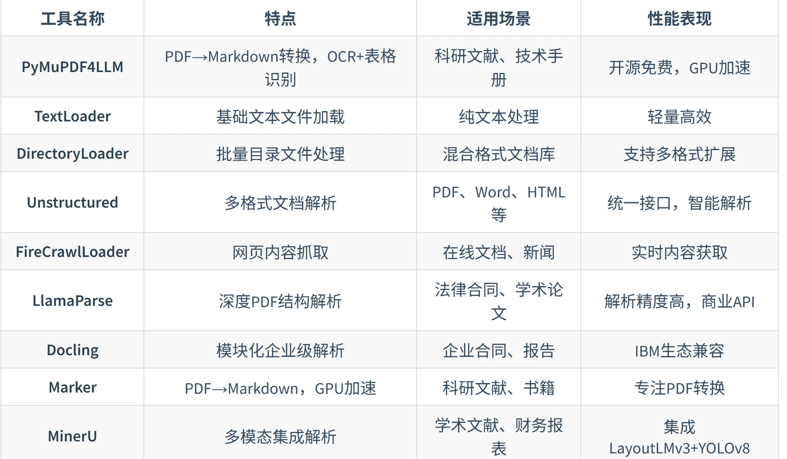


# 1. 数据准备

## 1.1 文档加载器

文档加载器负责将各种格式的非结构化文档（如PDF、Word、Markdown、HTML等）转换为程序可以处理的**结构化数据**。数据加载的质量会直接影响后续的索引构建、检索效果和最终的生成质量。

- 解析不同格式的文档，将文档内容提取为可处理的**纯文本**

- 解析过程中抽取文档来源、页码、作者等关键信息作为**元数据**

- 把文本和元数据整理成统一的数据结构，方便后续切分、向量化和入库

把杂乱的原始文档清洗对齐为适合检索和建模的标准化语料

## 1.2 文本分块

文本分块(Text Chunking) 是构建RAG的关键步骤，将加载后的长篇文档，切分成更小、更易于处理的单元；被切分出的文本块是后续向量检索和模型处理的**基本单元**

### 重要性

- 满足模型上下文限制：
	- **嵌入模型(Embedding Model)** :将文本块转换为向量。有严格的输入长度上限，超出限制的文本块在输入时都会被截断，导致信息丢失，生成的向量也无法代表原文的语义
		- 大多数嵌入模型都基于Transformer
		- 分词：输入的文本块分解成token
		- 向量化：为每个token生成一个高维向量表示
		- 池化：将所有token的向量**压缩**成一个单一的向量，这个向量代表了整个文本块的语义
		- 文本块越长，包含的语义点就越多，单一向量所承载的信息越稀释，关键细节被模糊化，降低检索的精度
	- **大语言模型(LLM)**：根据检索到的上下文，生成答案。也要有上下文窗口限制，比嵌入模型大得多。检索到所有文本块连同用户问题和提示词，都必须能被放入这个窗口中，如果单个块过大，就只能放进去几个相关的块，限制了LLM回答问题的广度
		- 如果提供给LLM的上下文块又大又杂，充满了与问题无关的噪音，模型就很难从中提取出最关键的信息来形成答案，从而导致回答质量下降或产生幻觉。

### 基础分块策略

1. 固定大小分块
2. 递归字符分块

# 2. 索引构建

# 3. 检索优化

# 4. 生成集成

# 5. 评估

