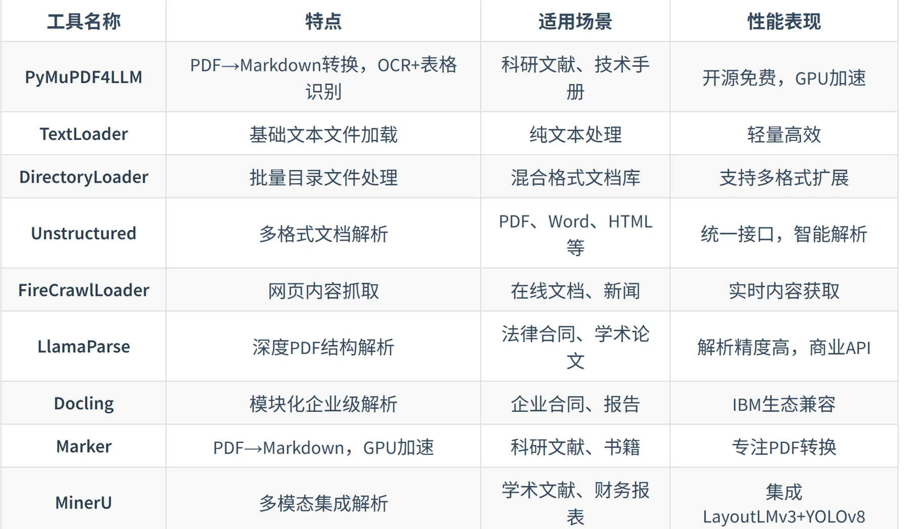
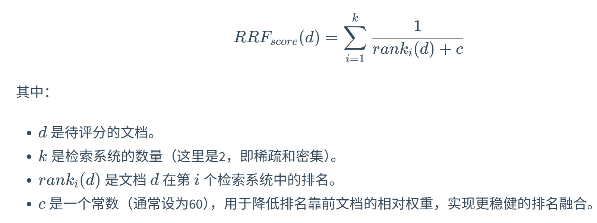
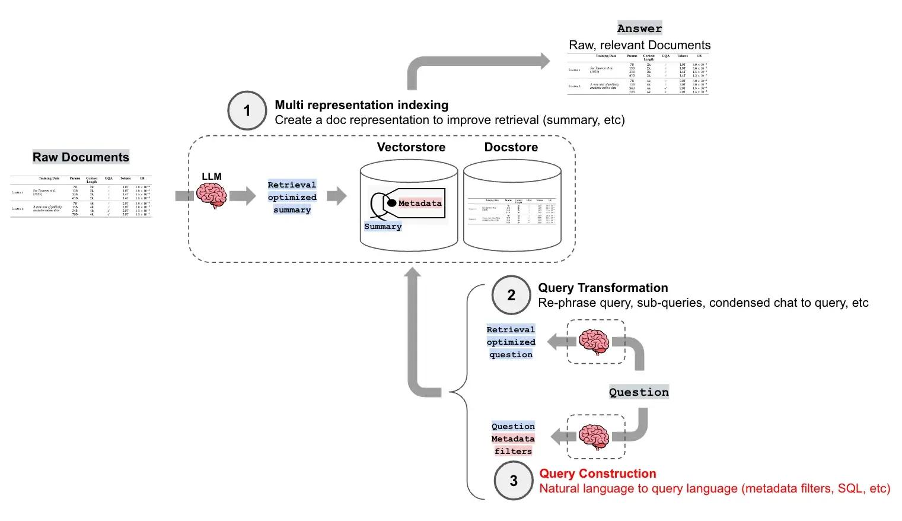
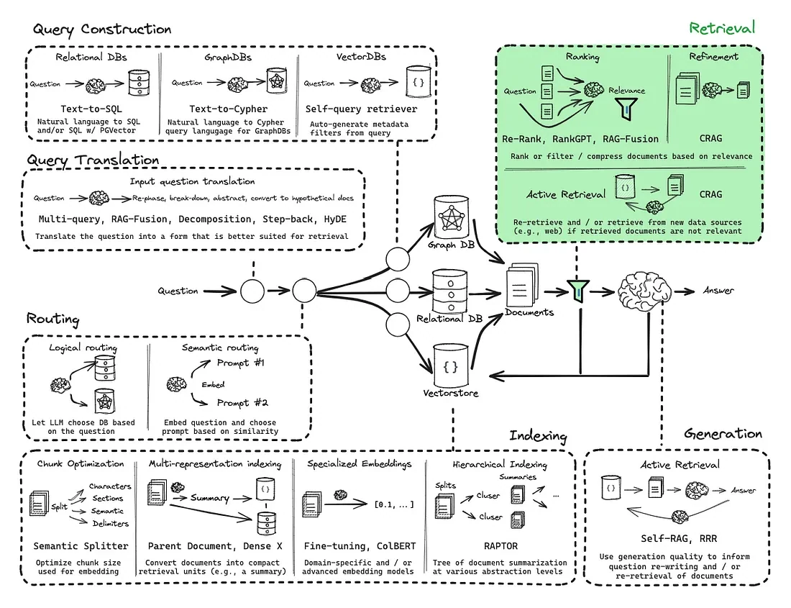
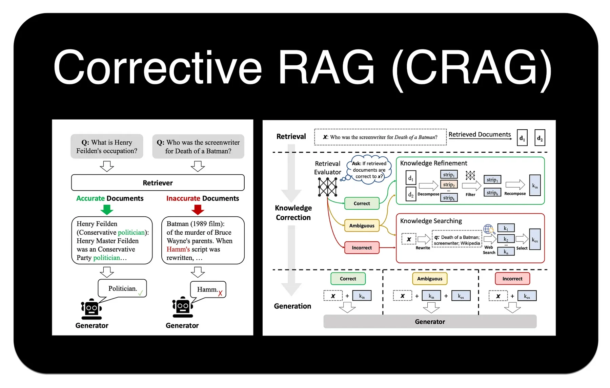



提问前：分片-->索引

提问后：召回-->重排-->生成

# 数据准备

## 1. 文档加载器

文档加载器负责将各种格式的非结构化文档（如PDF、Word、Markdown、HTML等）转换为程序可以处理的**结构化数据**。数据加载的质量会直接影响后续的索引构建、检索效果和最终的生成质量。

- 解析不同格式的文档，将文档内容提取为可处理的**纯文本**

- 解析过程中抽取文档来源、页码、作者等关键信息作为**元数据**

- 把文本和元数据整理成统一的数据结构，方便后续切分、向量化和入库

把杂乱的原始文档清洗对齐为适合检索和建模的标准化语料

## 2. 文本分块

文本分块(Text Chunking) 是构建RAG的关键步骤，将加载后的长篇文档，切分成更小、更易于处理的单元；被切分出的文本块是后续向量检索和模型处理的**基本单元**

### 重要性

- 满足模型上下文限制：
	- **嵌入模型(Embedding Model)** :将文本块转换为向量。有严格的输入长度上限，超出限制的文本块在输入时都会被截断，导致信息丢失，生成的向量也无法代表原文的语义
		- 大多数嵌入模型都基于Transformer
		- 分词：输入的文本块分解成token
		- 向量化：为每个token生成一个高维向量表示
		- 池化：将所有token的向量**压缩**成一个单一的向量，这个向量代表了整个文本块的语义
		- 嵌入过程中信息损失：文本块越长，包含的语义点就越多，单一向量所承载的信息越稀释，关键细节被模糊化，降低检索的精度
	- **大语言模型(LLM)**：根据检索到的上下文，生成答案。也要有上下文窗口限制，比嵌入模型大得多。检索到所有文本块连同用户问题和提示词，都必须能被放入这个窗口中，如果单个块过大，就只能放进去几个相关的块，限制了LLM回答问题的广度
		- 生成过程困难：如果提供给LLM的上下文块又大又杂，充满了与问题无关的噪音，模型就很难从中提取出最关键的信息来形成答案，从而导致回答质量下降或产生幻觉。
	- 主题稀释导致检索失败：如果一个块包含太多不相关主题，语义就会被稀释，导致在检索时无法被精确匹配
- 块不是越大越好，过大会严重影响RAG的性能

### 基础分块策略

- 固定大小分块：最简单直接分块方法，按照段落分割，然后只能合并
	- 优点：实现简单、处理速度快、开销小
	- 缺点：可能会在语义边界切断文本，影响内容的完整性和连贯性
- 递归字符分块：用一组有层次结构的分割符进行递归分割
	- 首先尝试使用最高优先级的分隔符（如段落标记）来切分文本。如果切分后的块仍然过大，会继续对这个大块应用下一优先级分隔符（如句号），如此循环往复，直到块满足大小限制
	- 优点：有效平衡语义完整性和块大小控制
- 语义分块：在语义主题发生显著变化的地方切分
	- 句子分割、上下文感知嵌入、计算语义距离、识别断点、合并成块
- 基于文档结构的分块：“先按标题分组，再按需细分”
# 索引构建

## 1. 向量嵌入
向量嵌入（Embedding）是一种将真实世界中复杂、高维的数据对象（如文本、图像、音频、视频等）转换为数学上易于处理的、低维、稠密的连续数值向量的技术。

### Embedding在RAG中的作用

1. 语义检索的基础
	1. 离线索引构建：将知识库中文档切分之后，使用Embedding模型，每个文档块(Chunk)转化为向量，存入专门的向量数据库中
	2. 在线查询检索：用户提问，使用同一个Embedding模型将用户问题也转换为一个向量
	3. 相似度计算：在向量数据库中，计算问题向量和所有文档块向量的相似度
	4. 召回上下文：选取相似度最高的Top-K个文档块，作为补充上下文，与原始问题一起送给大模型生成最终答案
2. 决定检索质量的关键：Embedding 的质量直接决定了 RAG 检索召回内容的准确性与相关性。一个优秀的 Embedding 模型能够精准捕捉问题和文档之间的深层语义联系，即使用户的提问和原文的表述不完全一致。
### 嵌入模型训练原理

当前主流嵌入模型通常是基于BERT变体，通过训练获得强大的语义理解能力

BERT通过堆叠多个Transformer Encoder层获得深度的双向表示学习网络

BERT使用系监督学习，允许模型从海量的、无标注的文本数据中学习知识

1. 主要训练任务：赋予了模型强大的基础语义理解能力
	1. 掩码语言模型 (Masked Language Model, MLM)
			过程：
			随机地将输入句子中 15% 的词元（Token）替换为一个特殊的 [MASK] 标记。
			让模型去预测这些被遮盖住的原始词元是什么。
			目标：通过这个任务，模型被迫学习每个词元与其上下文之间的关系，从而掌握深层次的语境语义。
	2. 下一句预测 (Next Sentence Prediction, NSP)
			目标：这个任务让模型学习句子与句子之间的逻辑关系、连贯性和主题相关性。
			重要说明：后续的研究（如 RoBERTa）发现2，NSP 任务可能过于简单，甚至会损害模型性能。因此，许多现代的预训练模型（如 RoBERTa、SBERT）在预训练阶段移除了 NSP。
2. 效果增强策略：为了在检索任务中表现更佳，现代嵌入模型通常会引入更具针对性的训练策略
	1. 度量学习
		思想：直接以“相似度”作为优化目标。
		方法：收集大量相关的文本对（例如，（问题，答案）、（新闻标题，正文））。训练的目标是优化向量空间中的相对距离：让“正例对”的向量表示在空间中被“拉近”，而“负例对”的向量表示被“推远”。关键在于优化排序关系，而非追求绝对的相似度值（如 1 或 0），因为过度追求极端值可能导致模型过拟合。
	2. 对比学习

## 2. 多模态嵌入

Word2Vec 为 BERT 的上下文理解铺路，而 BERT 又为 CLIP 等模型的跨模态能力奠定了基础。

多模态嵌入：将不同类型的数据，映射到同一个共享的向量空间

关键实现：在于解决跨模态对齐

### CLIP(Contrative Language-Image Pre-Training)

双编码器架构，一个图像编码，一个文字编码器，将图像文本映射到同一个共享向量空间中

训练过程中采用对比学习，目标是最大化正确图文对的向量相似度，最小化所有错误配对的相似度

Zero-shot 零样本识别能力：图文检索问题，只需要计算图片向量和文本向量的相似度

## 3. 向量数据库

### 主要功能

- 高效相似性搜索：使用专门的索引技术( HNSW、IVF )，在十亿级别的向量中实现毫秒级的**近似最相邻查询**
- 高维数据存储与管理：专门存储高维向量，支持对向量数据进行增删改查
- 查询能力：除了基本的相似性搜索，还支持标量字段过滤查询、范围查询、聚类分析等
- 数据与模型生态集合：与主流的AI框架和机器学习工作无缝集成

利用传统数据库**存储业务元数据和结构化信息**，而向量数据库则专门负责处理和检索由 AI 模型产生的海量向量数据

### 原理

向量数据库通常采用四层架构，通过存储层、索引层、查询层和服务层的协同工作来实现高效相似性搜索
- 存储层负责存储向量数据和元数据，优化存储效率并支持分布式存储；
- 索引层维护索引算法（HNSW、LSH、PQ等），负责索引的创建与优化，并支持索引调整；
- 查询层处理查询请求，支持混合查询并实现查询优化；
- 服务层管理客户端连接，提供监控和日志能力，并实现安全管理。
## 4. 索引优化
### 上下文拓展--句子窗口

问题：
- 使用小块文本进行索引可以获得更高的精确度，但是小块文本缺乏足够上下文
- 大块文本虽然上下文丰富但是容易引入噪音
**为检索精确性而索引小块，为上下文丰富性而检索大块**

### 结构化索引

问题：
随着知识库规模不断扩大，传统RAG方法效率比较慢；查询如果只和一两个文档相关时，对整个文档库进行向量搜索，效率低下还可能检索结果不精准

方法：
结构化索引就是在索引文本块的同时，附加结构化的元数据；比如文件名、文档创建日期、章节标题等
- 元数据预过滤
- 向量搜索

# 检索优化

## 1. 混合检索 Hybrid Search

同时利用稀疏向量的**关键词精确匹配能力**和密集向量的**语义理解能力**，以克服单一向量检索的局限性

稀疏向量( 词法向量 )：

- 基于词频统计的传统信息检索方法的数学表示
- 维度极高，但绝大多数元素为0的向量
- 文档视为一堆词的集合，不考虑语法和顺序，向量的每个维度都直接对应一个具体的词
- 优点：可解释性极强--每个维度都代表一个确切的词，无需训练，能实现关键词的精确匹配
- 缺点：无法理解语义

密集向量( 语义向量 )：
- 通过深度学习模型学习到的数据的低维、稠密的浮点数表示
- 向量将原始数据映射到一个连续的充满意义的语义空间
- 向量之间的距离和方向代表了概念之间的关系
- 优点：理解同义词、近义词和上下文关系，泛化能力强
- 缺点：可解释性差，需要资源和数据进行模型训练，对未出现词的处理困难

### 倒数排序融合RRF

RRF不关心不同检索系统的原始得分，只关心每个文档在各自结果集中的排名
一个文档在不同检索系统中排名越靠前，得分越高

### 加权线性组合

先将不同检索系统的得分进行归一化，通过一个权重参数来线性组合，通过调整参数的值来控制语义和关键词在最终排序中的贡献比例

## 2. 查询构建

问题：当处理更复杂的数据( 结构化数据SQL数据库、半结构化数据、图数据 )，用户的查询可能不只是简单的语义匹配，而是选哟包含复杂的过滤条件、聚合操作或关系查询

查询构建：利用大语言模型（LLM）的强大理解能力，将用户的自然语言查询“**翻译**”成针对特定数据源的结构化查询语言或带有过滤条件的请求

### 文本到元数据过滤器

元数据提供了在语义搜索之外进行精确过滤的可能

自检索查询器：
1. 定义元数据结构：向LLM清晰描述文档内容和每个元数据字段的含义和类型
2. 查询解析：当用户输入一个自然语言时，自查询检索器回调用LLM，查询分解为两部分
	- 查询字符串：用于进行语义搜索部分
	- 元数据过滤器：从查询中提取出结构化过滤条件
3. 执行查询：检索器将解析出的查询字符串和元数据过滤器发送给向量数据库，执行一次同时包含语义搜索和元数据过滤的查询

## 3. Text2SQL

### 挑战

1. 幻觉问题：LLM可能会想象出数据库中不存在的表或字段，导致生成的SQL语句无效
2. 对数据库结构理解不足：LLLM需要准确理解表的结构、字段恨意以及表与表之间的关联关系
3. 处理用户输入的模糊性：用户提问可能存在拼写或者表达不规范，需要模型有一定的容错和推理能力

### 优化策略

1. 提供精确的数据库模式：提供数据库中相关表的 `CREATE TABLE` 语句，让它了解数据库的结构，包括表名、列名、数据类型和外键关系
2. 提供少量高质量的示例：在提示（Prompt）中加入一些“问题-SQL”的示例对，可以极大地提升LLM生成查询的准确性
3. 利用RAG增强上下文：为数据库构建一个专门的知识库，其中不仅包含表的DDL（数据定义语言），还可以包含：
	- 表和字段的详细描述
	- 同义词和业务术语：例如，将用户的“花费”映射到数据库的 `cost` 字段。
	- 复杂的查询示例：提供一些包含 `JOIN`、`GROUP BY` 或子查询的复杂问答对
- 当用户提问时，系统首先从这个知识库中检索最相关的信息（如相关的表结构、字段描述、相似的Q&A），然后将这些信息和用户的问题一起组合成一个内容更丰富的提示，交给LLM生成最终的SQL查询。这种方式极大地降低了“幻觉”的风险，提高了查询的准确度。
4. 错误修正和反思：生成SQL后，系统尝试执行它，如果数据库返回错误，就将错误信息反馈给LLM，让他反思修正SQL

### 完整流程模拟

1. 知识库检索
	用户输入：年龄大于30的用户有那些
	检索过程：
		1. BGE-M3模型将查询文本转换为768维向量
		2. Milvus在知识库中进行语义相似度搜索
		3. 返回最相关的5条知识，按相似度排序
	检索结果：
		DDL知识：表名、结构、约束
		Q-SQL示例：历史问答对，为新问题提供参考模式
		表描述：表和字段的业务含义，帮助理解数据语义
2. SQL生成
	上下文构建：根据检索到的知识整理成结构化的上下文信息
		表结构信息：表名、DDL定义、字段约束
		表和字段描述
		查询示例
	SQL生成过程：
		1. LLM分析用户问题的意图：查询满足年龄条件的用户
		2. 识别关键信息：年龄字段(age)、比较操作、阈值
		3. 参考示例模式：从`WHERE age > 25`学习到`WHERE age > 数值`的模式
		4. 模式应用：将用户的实际数值30替换示例中的25
		5. 生成SQL
3. SQL执行与结果处理
	安全处理
	数据库执行
通过这个**语义理解 → 结构化查询 → 数据过滤 → 结果输出**的完整流程，框架成功将用户的自然语言问题转换为精确的数据库查询结果。
## 4. 查询重构与分发

问题：用户的原始问题往往不是最优的检索输入，过于复杂、包含歧义，或者与文档的实际措辞存在偏差。为了解决这些问题，我们需要<mark>🟠在检索之前对用户的查询进行“预处理”</mark>，这就是本节要探讨的**查询重构与分发**

1. **查询翻译（Query Translation）**：将用户的原始问题转换成一个或多个更适合检索的形式。
2. **查询路由（Query Routing）**：根据问题的性质，将其智能地分发到最合适的数据源或检索器。

### 查询翻译

目标是弥合用户自然语言提问与文档库中存储信息之间的“语义鸿沟”。通过重写、分解或扩展查询，显著提升检索的准确率

#### 提示工程

**让 LLM 直接构建出查询指令**

要求 LLM 直接分析用户的意图，并生成一个结构化（例如 JSON 格式）的指令，告诉我们的代码应该如何操作。

1. 设计一个新的提示词（Prompt），要求 LLM 输出 JSON 格式的排序指令
2. 在代码中调用 LLM，解析其返回的 JSON 指令，并执行相应的排序操作

#### 多分解查询

将这个复杂问题拆分成多个更简单、更具体的子问题。然后，系统分别对每个子问题进行检索，最后将所有检索到的结果合并、去重，形成一个更全面的上下文，再交给 LLM 生成最终答案。

- **原始问题**：“在《流浪地球》中，刘慈欣对人工智能和未来社会结构有何看法？”
- **分解后的子问题**：
    - “《流浪地球》中描述的人工智能技术有哪些？”
    - “《流浪地球》中描绘的未来社会是怎样的？”
    - “刘慈欣关于人工智能的观点是什么？
- 最后，它将所有检索到的文档合并并去重，形成一个更全面的上下文，再传递给语言模型生成最终答案。通过这种策略，极大地丰富了检索结果，在有些应用中可以有效提升后续生成环节的质量。

#### 退步提示

其核心流程分为两步：

（1）**抽象化**：首先，引导 LLM 从用户的原始具体问题中，生成一个更高层次、更概括的“退步问题”（Step-back Question）。这个退步问题旨在探寻原始问题背后的通用原理或核心概念。

（2）**推理**：接着，系统会先获取“退步问题”的答案（例如，一个物理定律、一段历史背景等），然后将这个通用原理作为上下文，再结合原始的具体问题，进行推理并生成最终答案。

示例：
- **原始问题**：“如果理想气体的温度增加2倍，体积增加8倍，其压力会如何变化？”
- **退步问题**：“这个问题背后的物理原理是什么？”
- **推理过程**：首先回答退步问题，得到“理想气体定律 PV=nRT”。然后基于这个定律，代入具体数值进行计算，最终得出压力变为原来的1/4。

通过先检索或生成高层知识，再进行具体推理，退步提示能够帮助模型构建一个更坚实的逻辑基础，从而提高在复杂问答场景下的准确性。
### 查询路由

用于优化复杂 RAG 系统的一项关键技术。当系统接入了多个不同的数据源或具备多种处理能力时，就需要一个“智能调度中心”来分析用户的查询，并动态选择最合适的处理路径。其本质是替代硬编码规则，通过语义理解将查询分发至最匹配的数据源、处理组件或提示模板，从而提升系统的效率与答案的准确性。

应用场景：
- 数据源路由：根据意图查询定位到不同的知识库
- 组件路由：根据问题的复杂性，分配给不同组件处理
- 提示模板路由：为不同类型的任务动态选择最优的提示词模板，以优化生成效果

实现方法：
1. 基于LLM的意图识别：通过设计一个包含路由选项的提示词，让大语言模型（LLM）直接对用户的查询进行分类，并输出一个代表路由选择的标签。
	- 定义清晰的路由选项
	- LLM分析查询输出决策标签
	- 代码根据标签调用相应的检索器或者工具
2. 嵌入相似性路由：通过计算用户查询与预设的“路由示例语句”之间的向量嵌入相似度来做出决策
	- 定义路由表述并向量化
	- 定义目标链
	- 定义路由函数
	- 组合调用
## 进阶

### 重排序

- RRF：是一种简单而有效的**零样本**重排方法，不依赖于任何模型训练，而是纯粹基于文档在多个不同检索器结果列表中的**排名**来计算最终分数。
- RankLLM：RankLLM 代表了一类直接利用大型语言模型本身来进行重排的方法。其基本逻辑非常直观：
	- 既然 LLM 最终要负责根据上下文来生成答案，那么为什么不直接让它来判断哪些上下文最相关呢？
	- 通过一个精心设计的提示词来实现。该提示词会包含用户的查询和一系列候选文档（通常是文档的摘要或关键部分），然后要求 LLM 以特定格式（如 JSON）输出一个排序后的文档列表，并给出每个文档的相关性分数。
- Cross-Encoder重排：工作原理是将查询（Query）和每个候选文档（Document）**拼接**成一个单一的输入，然后将这个整体输入到一个预训练的 Transformer 模型（如 BERT）中，模型最终会输出一个单一的分数（通常在 0 到 1 之间），这个分数直接代表了文档与查询的**相关性**。
- ColBERT重排：
	1. **独立编码**：ColBERT 分别为查询（Query）和文档（Document）中的每个 Token 生成上下文相关的嵌入向量。这一步是独立完成的，可以预先计算并存储文档的向量，从而加快查询速度。
	2. **后期交互**：在查询时，模型会计算查询中每个 Token 的向量与文档中每个 Token 向量之间的最大相似度（MaxSim）。
	3. **分数聚合**：最后，将查询中所有 Token 得到的最大相似度分数相加，得到最终的相关性总分。

### 压缩

“压缩”技术旨在解决一个常见问题：初步检索到的文档块（Chunks）虽然整体上与查询相关，但可能包含大量无关的“噪音”文本。

压缩的目标就是对检索到的内容进行“压缩”和“提炼”，只保留与用户查询最直接相关的信息。这可以通过两种主要方式实现：

1. **内容提取**：从文档中只抽出与查询相关的句子或段落。
2. **文档过滤**：完全丢弃那些虽然被初步召回，但经过更精细判断后认为不相关的整个文档

### 校正

传统的 RAG 流程有一个隐含的假设：检索到的文档总是与问题相关且包含正确答案。然而在现实世界中，检索系统可能会失败，返回不相关、过时或甚至完全错误的文档。如果将这些“有毒”的上下文直接喂给 LLM，就可能导致幻觉（Hallucination）或产生错误的回答。

**校正检索（Corrective-RAG, C-RAG）** 正是为解决这一问题而提出的一种策略[6](https://datawhalechina.github.io/all-in-rag/#fn-6)。思路是引入一个“自我反思”或“自我修正”的循环，在生成答案之前，对检索到的文档质量进行评估，并根据评估结果采取不同的行动。
C-RAG 的工作流程可以概括为 **“检索-评估-行动”** 三个阶段：
1. **检索 (Retrieve)** ：与标准 RAG 一样，首先根据用户查询从知识库中检索一组文档。
    
2. **评估 (Assess)** ：这是 C-RAG 的关键步骤。如图所示，一个“检索评估器 (Retrieval Evaluator)”会判断每个文档与查询的相关性，并给出“正确 (Correct)”、“不正确 (Incorrect)”或“模糊 (Ambiguous)”的标签。
    
3. **行动 (Act)** ：根据评估结果，系统会进入不同的知识修正与获取流程：
    
    - **如果评估为“正确”**：系统会进入“知识精炼 (Knowledge Refinement)”环节。如图，它会将原始文档分解成更小的知识片段 (strips)，过滤掉无关部分，然后重新组合成更精准、更聚焦的上下文，再送给大模型生成答案。
    - **如果评估为“不正确”**：系统认为内部知识库无法回答问题，此时会触发“知识搜索 (Knowledge Searching)”。它会先对原始查询进行“查询重写 (Query Rewriting)”，生成一个更适合搜索引擎的查询，然后进行 Web 搜索，用外部信息来回答问题。
    - **如果评估为“模糊”**：同样会触发“知识搜索”，但通常会直接使用原始查询进行 Web 搜索，以获取额外信息来辅助生成答案。

通过这种方式，C-RAG 极大地增强了 RAG 系统的鲁棒性。不再盲目信任检索结果，而是增加了一个“事实核查”层，能够在检索失败时主动寻求外部帮助，从而有效减少幻觉，提升答案的准确性和可靠性。
# 4. 生成集成

## 格式化生成

为什么需要格式化生成？
- LLM返回一个包含产品名称、价格、特性和购买链接的 JSON 列表，而不是一段描述性文字，以便前端直接渲染成商品卡片
- 自然语言转API调用：需要将查询解析成一个结构化的API请求
- 数据自动提取：从一篇新闻文章中，自动抽取出时间、事件、地点、设计人物等关键信息，并且节后话形式存到shujuku

## 格式化生成的实现方法

### Output Parsers

LangChain 提供了一个强大的组件——`OutputParsers`（输出解析器），专门用于处理 LLM 的输出，其主要思想是在发送给 LLM 的提示（Prompt）中自动注入一段关于如何格式化输出的指令，并在得到结果后将 LLM 返回的纯文本字符串解析成预期的结构化数据

### LlamaIndex的输出解析

响应合成和结构化输出

- **定义 Schema**：开发者首先定义一个 Pydantic 模型，明确所需输出的数据结构、字段和类型。
- **引导生成**：LlamaIndex 会将这个 Pydantic 模型转换成 LLM 能理解的格式指令。如果底层的 LLM 支持 Function Calling，LlamaIndex 会优先使用该功能以获得更可靠的结构化输出。如果不支持，它会回退到将 JSON Schema 注入到提示词中的方法。
- **解析验证**：最后，LLM 返回的输出会被自动解析并用 Pydantic 模型进行验证，确保其类型和结构完全正确，最终返回一个 Pydantic 对象实例。

### Function Calling

Function Calling 的本质是一个多轮对话流程，让模型、代码和外部工具（如 API）协同工作。其核心工作流如下：

（1）**定义工具**：首先，在代码中以特定格式（通常是 JSON Schema）定义好可用的工具，包括工具的名称、功能描述、以及需要的参数。

（2）**用户提问**：用户发起一个需要调用工具才能回答的请求。

（3）**模型决策**：模型接收到请求后，分析用户的意图，并匹配最合适的工具。它不会直接回答，而是返回一个包含 `tool_calls` 的特殊响应。这个响应相当于一个指令：“请调用某某工具，并使用这些参数”。

（4）**代码执行**：应用接收到这个指令，解析出工具名称和参数，然后**在代码层面实际执行**这个工具（例如，调用一个真实的天气 API）。

（5）**结果反馈**：将工具的执行结果（例如，从 API 获取的真实天气数据）包装成一个 `role` 为 `tool` 的消息，再次发送给模型。

（6）**最终生成**：模型接收到工具的执行结果后，结合原始问题和工具返回的信息，生成最终的、自然的语言回答。

# 5. 评估

